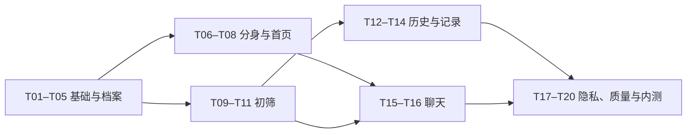

# 绒星 v1 全栈任务规划

> 面向执行者：先按模块拆成可独立评审的详细实施计划，再逐项执行；不要把下方未勾选任务视为已完成。执行时可使用 `superpowers:executing-plans`；是否采用子代理由用户及当时的工具政策决定。

**目标：** 交付可供 50–100 位猫主内测的 iOS / Android App，覆盖猫咪档案、数字分身、健康初筛、日常记录与聊天。

**架构：** 客户端通过 HTTPS 访问 FastAPI；关系数据存 MySQL，Redis/arq 处理队列与配额，媒体存对象存储，AI 服务通过 Provider 适配层调用。初筛红线和健康分由确定性规则计算，LLM 仅提供非红线建议文本。

**技术方向：** React Native + Expo、Zustand、FastAPI / Pydantic / SQLAlchemy / Alembic、MySQL、Redis/arq、OSS（本地 MinIO）、DashScope 适配层。版本、导航和原生插件以兼容性验证结果为准。

**需求依据：** [产品 Brief](../product/产品Brief.md)、[PRD](../product/PRD.md)、[FRD 与验收标准](../product/FRD.md)、[架构及 API](../architecture.md)、[项目与设计概览](../product/项目规划与设计参考.md)。FRD 是各功能规则与 AC 的明细来源；本文件是跨职能任务与依赖计划，不覆盖原文细节。

## 📌 全局约束与现状

- **2026-11-18 交接（M0 未验收）：** T03 邮箱注册、补发、数据库投递队列、登录、刷新令牌轮换及版本化协议同意已本地联调；T04 猫咪 CRUD 和首页多猫切换已接入。健康和聊聊仍为占位。SMTP 实投、生产级限流、短信、注销、正式协议和真机仍待验收。
- **T05 进行中：** 已有任务记录、幂等、认领、租约重试和授权查询；照片已实现 S3 兼容签名、归属与实际图片复核、验证版本固定。MySQL 8.4 临时实例已验证最新迁移及任务并发。下一步做真实存储验收、业务提交、Redis/arq 调度和移动端轮询。
- [ ] v1 支持猫、中文、iOS 15+ / Android 9+；深色模式不强制。三项核心能力——数字分身、健康初筛、聊天——均属首版范围。
- [ ] 红线由确定性规则直接触发紧急就医，绕过 LLM 且不受普通初筛配额限制；紧急结果、聊天、音频解读与喂养参考展示 FRD 标准边界文案。
- [ ] 媒体仅作存证，不进行诊断；叫声解读属于娱乐性参考；训练授权默认关闭，v1 不实际使用用户数据训练。
- [ ] 临床相关内容需兽医专业人员评审，权限、隐私、账号注销及真实数据处理需在上线前完成专项核验。
- [ ] 截至本计划编制时，Figma UI 曾提示更改保存在本地并等待同步。团队共享前确认联网同步成功及访问权限；不要修改共享权限作为默认步骤。

## 🎨 Figwright 连接与设计交付约定

Figwright 已连接 Figma 文件 [Untitled / 绒星](https://www.figma.com/design/sGhmzVC6reNoJdpy73X1zI/Untitled)，当前页面 `18:93`；原型流为「绒星 · 首页体验」。以下映射是设计参考，不等于功能已经实现：

| 设计对象 | Figma 画板 | 主要任务 | 本地快照 |
| --- | --- | --- | --- |
| 基础、组件、规范 | [基础](https://www.figma.com/design/sGhmzVC6reNoJdpy73X1zI/Untitled?node-id=21-115) · [组件](https://www.figma.com/design/sGhmzVC6reNoJdpy73X1zI/Untitled?node-id=21-116) · [原则](https://www.figma.com/design/sGhmzVC6reNoJdpy73X1zI/Untitled?node-id=21-117) | T02、所有移动端任务 | — |
| 首页 `22:309` | [首页](https://www.figma.com/design/sGhmzVC6reNoJdpy73X1zI/Untitled?node-id=22-309) | T06、T08、T14 | [首页 PNG](../../视觉参考/22-309.png) |
| 健康 `23:393` | [健康](https://www.figma.com/design/sGhmzVC6reNoJdpy73X1zI/Untitled?node-id=23-393) | T09、T10、T12 | [健康 PNG](../../视觉参考/23-393.png) |
| 初筛入口 `23:394` | [初筛入口](https://www.figma.com/design/sGhmzVC6reNoJdpy73X1zI/Untitled?node-id=23-394) | T09、T10、T11 | [初筛 PNG](../../视觉参考/23-394.png) |
| 聊聊 `23:395` | [聊聊](https://www.figma.com/design/sGhmzVC6reNoJdpy73X1zI/Untitled?node-id=23-395) | T15、T16 | [聊聊 PNG](../../视觉参考/23-395.png) |
| 我的 `23:396` | [我的](https://www.figma.com/design/sGhmzVC6reNoJdpy73X1zI/Untitled?node-id=23-396) | T04、T05、T17 | [我的 PNG](../../视觉参考/23-396.png) |

执行每个设计相关任务：

1. 在目标 Figma 文件打开 Figwright 插件，调用 `ping`；多文件时先 `list_files` 并用 `use_file` 绑定正确会话。连接失败则保留 PNG 作为视觉快照并记录阻塞，恢复后重新读取设计。
2. 用 `get_design_context` 对目标画板读取 `detail: full`、`dedupeComponents: true`；再查 `get_variable_defs`、`get_styles`、`get_local_components` 和 `get_motion_context`。已有代码后运行 `component_map`、`token_map`、`icon_map`，优先复用匹配资产。
3. 根据 Figma 树和自动布局、变量与文字样式实现，不从截图估算尺寸或色值；现有画板部分层级是自由定位示意，实现前由设计整理可复用结构和响应式约束，禁止逐层照搬绝对坐标作为响应式方案。
4. 图片和矢量用 Figwright 的素材导出工具取得可授权源资产；当前猫咪是参考图裁剪，导航图标为示意，正式交付需替换或核实授权。实现后在 iOS / Android 对照当前画板和状态复核，版本变化时重新读取而非依赖旧 PNG。

视觉基线：白色背景、暖橙主操作、浅暖灰卡片、深色文字；以当前 Figma 变量及样式的实际值为准。已画板仅覆盖默认/示例状态，缺失页面与失败、空态、权限、加载、长文及无障碍状态必须先设计；涉及真实健康结果以 FRD 与专业评审文案为准。

已发现设计与需求不一致：初筛入口画板写有「每天可做一次」，但 PRD / FRD 规定普通初筛默认每日 10 次、红线不限额。T09 设计评审时需修正画板与实际文案，并核验其他示例内容，不能按画面实现错误限额。

## 🧭 建议依赖与阶段

| 阶段 | 参考周次 | 主要任务 | 阶段出口 |
| --- | --- | --- | --- |
| M0 | 1–2 | T01–T05；先完成关键设计及工程环境 | 双端运行、同意与登录、每猫独立档案在测试环境可用 |
| M1 | 3–5 | T06–T08；初筛设计和规则可并行准备 | 分身任务可轮询、超时可恢复；首页真实数据与空态可见 |
| M2 | 6–8 | T09–T11 | 完整问卷至规则结果；六类红线、配额绕行和降级测试通过 |
| M3 | 9–11 | T12–T16；T17 贯穿开发 | 记录、复查、聊天跨端闭环可用；AI 成本及异常可观察 |
| M4 | 12 | T18–T20 | 专业评审、真实设备测试、发布门槛和双端内测包齐备 |

12 周来自 PRD 的参考安排，假设有移动端、后端、设计、测试及产品能力；人员投入、预算、供应商、证书和发布资质未确认，须在 T01 后估算并更新。安全与隐私工作不能推迟到最后一周。

## 🛠️ 全栈任务清单

任务均为待办；负责人为建议角色而非已分配人员。每个任务的 FRD AC 是可执行测试依据；在具体实现计划中再细化到实际文件、接口类型、测试命令和工时，避免在尚无代码时虚构已经存在的模块。

### T01 · 启动、技术验证与环境（P0，M0）

**负责人：** 技术负责人 / 产品 / 设计；**依赖：** 无；**对应：** 架构总览、PRD 发布计划。

- [ ] 确定团队容量、里程碑、需求版本、开发/测试环境、域名证书、短信/邮箱、对象存储、AI 配额及双端签名；记录负责人和外部依赖。
- [ ] 核对架构中「React Navigation」与目录示例「Expo Router」的差异，选择一套导航方案并留决策记录；验证目标 Expo SDK 与 Notifee、视频、录音、SQLite、构建分发的兼容性。
- [ ] 建立客户端和后端骨架、MySQL/Redis/MinIO 本地环境、配置模板和健康检查；不将密钥写入客户端或仓库。
- [ ] 验收：双端测试构建可启动、API 健康检查与迁移在隔离环境执行成功；记下依赖版本及可重复启动方法。

### T02 · 设计系统、导航与视觉对照（P0，M0）

**负责人：** 设计 / 移动端；**依赖：** T01；**参考：** 基础、组件、首页及四 Tab 画板。

- [ ] 用 Figwright 读取现有变量、样式、组件与页面，建立代码中的颜色、排版、间距、按钮、卡片、状态、输入和底部导航映射；图标与图片用可授权正式资产。
- [ ] 将自由定位示意整理为可适配宽度、内容与安全区的布局；补焦点、加载、禁用、错误、空态、读屏标签和至少 44×44 pt 触控区域。
- [ ] 验收：iOS / Android 真实设备检查基准画板、长文本和系统字号；深色文字在橙色按钮上对比度与状态非仅靠颜色表达均经测试。

### T03 · 账号、会话与同意（P0，M0）

**负责人：** 后端 / 移动端；**依赖：** T01；**需求：** F01、F12-1/2/3。

- [ ] 设计首启授权与登录/注册状态；实现手机号验证码、邮箱密码、邮箱验证、凭证绑定、JWT 刷新轮转及版本化 consent 记录。
- [ ] 落实验证码 TTL 5 分钟、60 秒发送限频、每日 10 次、5 次错误锁 15 分钟；密码 ≥8 位且含字母数字并以 argon2id 存储；训练授权单独且默认关闭。
- [ ] 验收：执行 AC-01-1～4、AC-12-1～3；覆盖验证码过期、重放、重复凭证、未验证邮箱、协议升级重签及未同意接口拒绝。

### T04 · 猫咪档案与多猫隔离（P0，M0）

**负责人：** 后端 / 移动端；**依赖：** T03；**需求：** F02；**参考：** 首页、我的。

- [ ] 设计建档、编辑、切换、删除确认与空态；实现猫咪 CRUD、所有权检查、软删除、当前猫咪状态及每账号默认上限 5 只。
- [ ] 名称必填、生日允许未知；最新体重来自体重记录；切猫清理并刷新首页、状态、分身和聊天上下文。
- [ ] 验收：AC-02-1～4；越权统一 404；删除后相关内容不可见，切换猫时不串数据；覆盖重复提交与跨账号访问。

### T05 · API 契约、任务与存储底座（P0，M0）

**负责人：** 后端 / 移动端 / 运维；**依赖：** T01、T03；**需求：** 架构「异步任务与轮询契约」「API 设计」。

- [x] 完成版本化 API、统一错误 envelope 和客户端认证刷新；分页随未来列表接口落地（现有列表均有硬上限）。
- [x] 照片 API：私有桶短期签名、猫咪归属、到期检查、大小与内容解码复核，并固定已验证的对象版本；真实存储验收已用一次性 MinIO 版本化桶完成（生产 OSS 待凭证）。
- [x] 首页按猫咪选择照片并显式确认上传；网页用真实 API 和模拟对象存储验证切猫隔离、非法图片拒绝和成功确认。
- [ ] iOS／Android 真机验收待设备；过期未验证票据已由 worker 定期清理（1 小时宽限），被引用旧版本按 VersionId 保留；按初筛和聊天需求扩展视频／音频，不把照片 API 当作通用媒体接口。
- [x] 本地任务底座：宠物关联记录、业务幂等键、原子认领与 15 分钟租约、最多两次重试、账号和协议授权状态查询。
- [x] 接入 Redis/arq worker 和过期任务调度（5 秒 sweep）；业务按进行中任务合并并发提交；移动端每 2 秒轮询，页面不可见时暂停，并按任务类型设置超时（avatar_batch 10 分钟）。
- [x] 验收：未授权及跨账号访问被拒；重复业务请求不重复入队；任务失败/超时可查询且不丢结果；签名过期或非法媒体被拦截（含 MinIO+Redis 端到端冒烟）。

### T06 · 分身素材与 Provider 管线（P0，M1）

**负责人：** 后端 / AI / 设计；**依赖：** T04、T05；**需求：** F03-1～4、F03-7/8。

- [ ] 设计上传、占位、生成与失败页；构建 Provider 接口及底图、7 动作片任务，准备 3 体型×7 动作占位资源；验证使用权、品质、耗时及成本。（Provider 接口与管线、3 体型×7 动作程序化占位库 v1、上传/占位舞台/失败与超时文案已落地；占位为临时程序化素材，授权素材替换与 Figma 对照待 T19，真实生成质量/耗时/成本待 DASHSCOPE_API_KEY。）
- [x] 上传 jpg/png/heic ≤10 MB 并前后端复核；任务幂等，生成失败重试 ≤2，10 分钟超时返回可理解的状态，不重复消耗配额。（配额硬限制待 T17；幂等合并与重试复用同一 media_id，不重复上传。）
- [ ] 验收：AC-03-1～4、7/8；提交后正常网络 5 秒内展示占位首帧；7 条中至少 5 条就绪判定可用，缺失动作有占位。（本地已验证：提交 202 即带占位清单并立即播放占位首帧、≥5/7 判可用、失败动作回退占位/静态底图、占位片公开下载与端到端冒烟；真机与真实生成验收待设备和凭证。）

### T07 · 播放器与资产缓存（P0，M1）

**负责人：** 移动端；**依赖：** T06；**需求：** F03-5/6、F04-4。

- [x] 在首页接入播放器与动作映射，支持个人片 → 通用片 → 静态呼吸回退；仅待机时切换、300ms 淡入淡出；文件缓存 LRU 默认上限 200 MB。（AvatarPlayer + action-map/asset-cache/player-machine 纯逻辑引擎 36 项 Node 测试；expo-sqlite 索引 + 文件缓存，web 直通浏览器缓存；映射版本化免发版更新。）
- [ ] 验收：AC-03-5/6、AC-04-4；模拟损坏、无缓存断网和单动作缺失不白屏，个人片只在下一待机循环替换。（逻辑层已验证：loop 边界切换/降级链/upgrade 下一待机循环/离线回退缓存映射；web 导出通过；真机播放观感、断网与损坏实机场景待设备验收。）

### T08 · 首页聚合与健康分（P0，M1–M2）

**负责人：** 后端 / 移动端；**依赖：** T04、T07、T10；**需求：** F04；**参考：** 首页。

- [x] 设计无记录、正常、观察、就医、紧急及扣分详情；聚合最新有效事件、今日饮食、最新体重、最近初筛、分身与猫咪切换。（GET /pets/{id}/health 聚合状态/分数/明细/最近初筛；饮食 T12、体重 T13 未交付前返回 null 引导空态；首页焦点+切猫重拉，health.state 驱动分身待机联动。）
- [x] 健康分纯规则计算、扣分明细及版本可追溯；无初筛及事件显示「未评估 --」，紧急状态常驻就医入口。（app/health.py 纯函数 14 测试；scoring.yaml sc-2026-11-19；observe 72h 读时衰减标「已衰减」计 0；复查覆盖 F06-3 提前实现；urgent 红卡+就医按钮+附录 F 文案。）
- [ ] 验收：AC-04-1～5；构造新猫、观察及紧急状态并核对详情、最高风险状态、多猫隔离和刷新一致性。（本地已验证：API 13 测试含新猫未评估/observe 90/urgent 40+就医卡/复查回 normal/升档替换/73h 衰减/多猫隔离/规则缺失 503；e2e 含 urgent→normal→observe 健康断言；移动端 77/77+web 导出。真机观感待设备。）

### T09 · 初筛问卷与红线规则（P0，M2）

**负责人：** 产品 / 兽医评审 / 后端 / 移动端；**依赖：** T04、T05；**需求：** F05-1～5、FRD 附录 A/B；**参考：** 健康与初筛入口。

- [x] 补问卷、动态追问、校验、紧急分流和素材存证界面；建立版本化症状 / 红线规则，精神与食欲必答，15 项常见症状及 6 类红线依照 FRD。（rules sx/rl/sc-2026-11-19 + triage 引擎 22 测试；移动端问卷／结果／历史四屏 + 存证上传；兽医评审为外部待办。）
- [x] 可选照片 ≤3 张、每张 ≤10 MB；视频 ≤1 个、≤50 MB / 30 秒，只存证不分析。命中红线返回 urgent 及就医清单，不调用 LLM、不受普通配额限制。（视频 ffprobe 双校验；配额 T17 未实现，红线天然不限额。）
- [ ] 验收：AC-05-1～5 和附录 B 全红线逐项测试；缺项定位、追问不完整拦截、同版本规则结果可复现，配额耗尽时红线流程仍可提交。（本地已验证：附录 A 分级表 38 行、附录 B 六类红线含派生、缺项 detail.fields 定位、rules_version+triage_json 快照可复现、e2e 冒烟含存证删除引用保护；配额耗尽场景待 T17、真机与兽医评审待外部。）

### T10 · 初筛结果、建议与降级（P0，M2）

**负责人：** 后端 / AI / 移动端；**依赖：** T09；**需求：** F05-6～8、F04。

- [x] 设计 normal / observe / vet / urgent 结果、就医清单及建议加载 / 失败态；规则结果先返回，异步建议 60 秒超时走按状态档模板。（screening_analysis 入队 + advice pending/ready/degraded 解析 + advice_templates.yaml at-2026-11-19；移动端结果页轮询与降级提示。）
- [x] 存储答案、症状、分级、规则版本、媒体引用和健康事件；LLM 不参与分级、健康分、红线决策。（T09 存档 + triage_json 快照；qwen-max 仅写 llm_advice/advice_json；urgent 零 LLM 零用量；ai_usage_logs 审计含失败尝试。）
- [ ] 验收：AC-05-6～8；模拟 AI 超时或失败，结果、规则与存档完整；每条结果含标准免责声明，不出现确诊/治疗措辞。（本地已验证：fake LLM 成功/禁词/瞬时失败/重试耗尽模板、60s 读时降级、urgent 模板即存无用量、e2e 建议链路；真实 qwen-max 质量与真机待外部。）

### T11 · 初筛历史、复查与本地提醒（P0，M2–M3）

**负责人：** 后端 / 移动端；**依赖：** T10；**需求：** F06、F10-1/3。

- [x] 建立按日倒序混排的健康时间线、详情与复查；observe 创建 24 小时本地通知，提前复查或删除猫时取消；拒绝权限时显示应用内提示。（/timeline/[petId] 按本地日分组倒序+状态色标+点击进结果页，diet/weight 槽位预留 T12/T13；lib/recheck-reminder.ts 纯逻辑 TDD：identifier recheck-{petId}-{screeningId}、fireAt=created_at+24h、data.route=/screening/{petId}；expo-notifications 适配层替代 notifee（偏差录 ledger 待 T19）；结果页 observe 调度、提交成功与删猫取消、健康页/结果页横幅+「我的」重新授权。）
- [x] 复查完成解决旧 screening 事件并重算；observe 未复查 72 小时后扣分衰减为 0，vet / urgent 不自动衰减。（T08 已实现并验证：复查覆盖 resolved_at+健康分即时重算；72h 读时衰减明细标「已衰减」；13 API 测试+e2e。）
- [ ] 验收：AC-06-1～4、AC-10-1/3；验证跨日时间线、通知点击跳转、权限拒绝、复查后状态和衰减审计。（本地已验证：timeline/recheck-reminder 11 测试含跨日/跨年分组、过期跳过、路由白名单；mobile 88/88+typecheck/lint+web 导出；复查覆盖与衰减后端 212 OK+e2e。通知真实触发/±5min/点击跳转与真机横幅观感待设备。）

### T12 · 饮食记录与喂养参考（P0，M3）

**负责人：** 后端 / 移动端；**依赖：** T04、T05；**需求：** F07；**参考：** 首页概览与快捷操作。

- [x] 设计记录表单、日期明细、空态和喂养参考；干/湿粮及其他类型、克数、时间与备注的校验按 FRD，支持每日合计和删除后重算。（/diet/[petId] 快录三步：类型 chips 默认干粮+克数输入+时间档位默认现在（≤7 天回改，预设档位替代 datetimepicker，偏差录 ledger）+备注；日明细前后翻页+合计+逐条删除重算；POST/GET/DELETE diet API 19 测试含本地日边界 tz480、归属、字段定位、503。）
- [x] 使用最新体重与 FRD 附录 E 公式计算参考；无体重引导记录；写入离线待同步与幂等重试属于 P1。（rules/feeding.yaml fd-2026-11-19+app/feeding.py 纯公式 12 测试；/feeding/[petId] 展示 RER/DER+干/湿 ±10% 区间+尾注一字不差；无体重 has_weight=false 只给引导；weight_records 表随 migration 11 建，录入 API/UI 属 T13；首页 diet_today/latest_weight 同源填充；时间线并入饮食。离线 P1 未做。）
- [ ] 验收：AC-07-1～4；50g 干粮为 190 kcal、跨本地自然日正确、4kg 已绝育成年猫约 238 kcal/日；页面注明参考值非医嘱。（本地已验证：AC-07-2/4 单测+API 本地日边界+删除重算+e2e 饮食段；mobile 95/95+typecheck/lint+web 导出；backend 243 OK+MySQL migration 11 head。≤3 步快录与页面观感待真机走查。）

### T13 · 体重、趋势及首页同步（P0/P1，M3）

**负责人：** 后端 / 移动端；**依赖：** T04、T05；**需求：** F08；**参考：** 首页、我的。

- [x] 设计录入、校验、记录列表和空态；体重范围 0.1–30kg、精度 0.01kg；记录后更新档案与喂养参考。90 天趋势及 7 天 ±10% 提示为 P1。（P1 已随本任务交付：react-native-svg 折线＋骤变红卡；真机观感待设备）
- [x] 验收：AC-08-1；测试上下限和同日多次保存；若交付 P1，执行 AC-08-2 并核对初筛跳转。（23 项单测＋e2e 本地验证：上下限/精度/同日保留/档案与喂养即时更新/loss −12.5% 提示与初筛跳转链接；真机走查待设备）

### T14 · 喂养提醒与浅离线（P1，M3）

**负责人：** 移动端 / 后端；**依赖：** T11、T12；**需求：** F07-5、F09-6、F10-2、非功能性需求。

- [x] 实现每猫喂养提醒，默认关闭；缓存聊天历史，饮食与文字请求失败加入持久队列，重试使用幂等键，音频需在线。（聊天页面与完整走查随 T15；底座已就绪）
- [ ] 验收：AC-07-5、AC-09-6、AC-10-2；飞行模式保存和恢复后不重复，提醒开关及时间正确持久化。（AC-07-5 幂等防重已本地单元+e2e 验证；AC-09-6 随 T15；AC-10-2 连续 3 天准时待真机）

### T15 · 文字聊天与安全边界（P0，M3）

**负责人：** 后端 / AI / 移动端；**依赖：** T04、T10；**需求：** F09-1/2/5/7；**参考：** 聊聊。

- [x] 建立每猫独立线程，最近 20 条上下文与最新初筛状态；输入 ≤500 字、回复 ≤100 字；常驻免责声明，红线关键词出现就医引导。
- [x] Figma 中的「症状识别」仅是示意；须设计并验证实际触发与确认，不能把示例气泡视为已实现的医学判断。（红线为确定性关键词触发＋就医引导卡确认，零 LLM，单测+e2e 验证；Figma 视觉对照待 T19）
- [x] 验收：AC-09-1/2/5/7；切猫隔离、红线关键词引导、异常输入和 AI 失败均可控；回复无诊断承诺。（本地单测+e2e 验证；情绪动作真机播放观感待设备）

### T16 · 录音解读与会话反馈（P0，M3）

**负责人：** 移动端 / 后端 / AI；**依赖：** T05、T15；**需求：** F09-3/4。

- [x] 设计麦克风权限、录音 1–60 秒、上传、解读中、结果和失败重试；异步任务超时 45 秒，低置信度 <0.4 标注「不太确定」（真机录音观感待设备）。
- [x] 验收：AC-09-3/4（本地验证）；权限拒绝及音频失败后文字聊天仍可用；解读明确为娱乐性参考，并有相应标准边界文案。

### T17 · 隐私、注销、配额与分享（P0/P1，贯穿）

**负责人：** 后端 / 移动端 / 产品；**依赖：** T03、T05；**需求：** F11、F12、F13；**参考：** 我的。

- [x] 实现版本化同意、训练授权默认关闭、媒体单条删除、账号冻结与计划清除；注销前二次确认并说明物理清除期限，验证数据库与对象存储同时处理（本地验证：15 天清除模拟含 OSS 版本删除核验与审计匿名化）。
- [x] 普通配额默认初筛 10、分身 3、聊天 50 / 日；测试期免费，订阅结构只预留接口且不接支付。用量展示与 GIF 分享是 P1，导出需包含水印、超时与重试（P1 已随 T17 交付：水印服务端烧录、60 秒超时、失败重试）。
- [x] 验收：AC-11-1～3、AC-12-1～6（本地验证：配额 429／红线豁免／热调、冻结与幂等注销、清除模拟与对象删除核验、日志脱敏）；AC-13-1/2 已交付（本地验证，真机分享面板待设备）。

### T18 · 观测、质量与安全（P0，贯穿）

**负责人：** 后端 / 运维 / 测试；**依赖：** T01；**需求：** FRD 非功能性要求。

- [x] 建立测试环境部署、迁移回滚演练、HTTPS、备份恢复、故障告警及日志脱敏；统计 AI 调用、任务失败、耗时、单用户成本和配额拒绝（本地已交付：一次性容器测试环境、MySQL head↔base 回滚演练、dump→恢复行数一致演练、结构化脱敏日志＋拒绝审计、ops_report 统计脚本、告警阈值建议；生产 HTTPS 证书与告警接线待部署，见 ../operations.md）。
- [x] 制定并运行 API、规则、所有权隔离、双端交互、弱网、权限、无障碍及集成回归；本地通知、媒体和后台轮询均覆盖真实设备（本地回归已运行：后端 407＋opt-in 1/12/1＋MySQL 7＋移动 155/typecheck/lint/web export，覆盖矩阵见 ../operations.md；真实设备覆盖待真机）。
- [ ] 验收：非 AI API p95 ≤500ms、首页冷启动 ≤3 秒、缓存分身首帧 ≤1 秒、crash-free 会话 ≥99% 按 FRD 测量；提供样本量、设备、环境及测量结果（本地 p95 门禁证据已有：n=1600 p95 2.34ms，进程内方法学；冷启动/首帧/crash-free 需真机与 Sentry，待外部）。

### T19 · 设计与专业评审（P0，贯穿）

**负责人：** 设计 / 产品 / 兽医专业评审 / 测试；**依赖：** T02、T09～T16 分阶段完成；**参考：** 所有画板。

- [ ] 每个 P0 流程补齐设计、文案与成功 / 失败状态；逐项记录 Figma 节点、变量、组件、需求编号、设计版本和验收结果。（本地交付：P0 流程矩阵＋文案审计完成，见原 DESIGN_REVIEW.md（已归档删除） §1-2；Figma 节点对照待外部）
- [ ] 对红线、分级、就医提示、喂养参考、音频娱乐定位和隐私文案组织相应专业评审；高风险问题修复后复验。（评审议程与材料已备，见原 DESIGN_REVIEW.md（已归档删除） §3；评审执行与签署待外部）
- [ ] 验收：完成双端视觉对照、文本对比度和读屏抽查；每个 P0 状态有设计及测试证据，参考素材版权与替代方案明确。（无障碍接线盘点与素材版权台账完成，见原 DESIGN_REVIEW.md（已归档删除） §4-5；双端对照／对比度／读屏待真机）

### T20 · 内测发布与指标（P0，M4）

**负责人：** 产品 / 测试 / 运维 / 移动端；**依赖：** T01–T19 的 P0；**需求：** PRD 指标、FRD 验收与内测门槛。

- [ ] 确认 TestFlight 和 Android APK 签名、分发和测试账户；制定版本回滚、问题收集和用户数据处理流程；先内部验证再向 50–100 名猫主内测。（发布 runbook／测试账户／回滚／问题收集／数据处理已完成，见原 RELEASE.md（已归档删除） §2-6；签名分发待凭证）
- [ ] 定义并核对周活跃记录宠物数、7 日留存、初筛完成率、红线就医提示点击率和聊天使用埋点；分别标识事件定义、分母、去重、权限与责任人。（指标定义完成，见原 RELEASE.md（已归档删除） §8；客户端埋点 SDK 待决策，服务端可算项已标注）
- [ ] 验收：FRD 内测门槛逐项有证据；所有阻断问题关闭，专业评审及隐私流程完成；留存 ≥30%、初筛完成率 ≥70% 是内测观察目标，不是上线前可预先宣称达到的结果。（门槛证据映射完成，见原 RELEASE.md（已归档删除） §9；内测执行与观察待外部）

## 📚 需求覆盖与执行顺序核对

| FRD | 任务 | FRD | 任务 |
| --- | --- | --- | --- |
| F01 账号 | T03 | F08 体重 | T13 |
| F02 档案 | T04 | F09 聊天 | T14–T16 |
| F03 分身 | T05–T07 | F10 提醒 | T11、T14 |
| F04 首页与健康分 | T08、T10 | F11 配额 | T17 |
| F05 初筛 | T09–T10 | F12 隐私 | T03、T17 |
| F06 历史与复查 | T11 | F13 分享 | T17 |
| F07 饮食 | T12、T14 | 非功能与发布 | T18–T20 |

优先产出顺序：T01 验证 → T02–T05 形成可运行底座 → T06–T08 / T09 并行准备 → T10–T13 完成健康闭环 → T15–T16 交付聊天 → T18–T20 全面验收。T14 与 T17 中的 P1 能否进入内测由产品明确，红线、安全及其他 P0 不可因排期自行省略。

尚需决策：明确项目开始日期和人员容量；解决导航方案及 Expo 原生模块兼容；确认云供应商、预算、测试账户、隐私文案与兽医审核责任人；确认 Figma 同步完成。上述信息影响工期和实现顺序，不能从现有设计推断。
