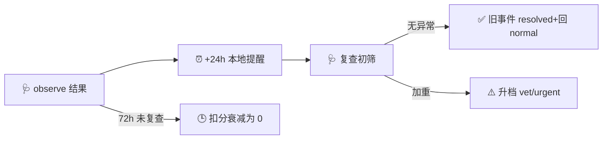
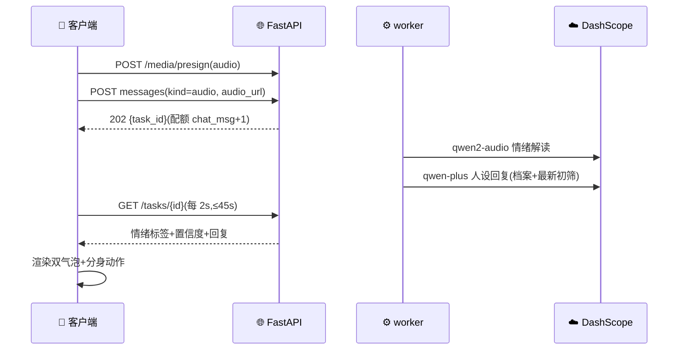

# 绒星(RongXing)功能需求文档 FRD

| 项 | 内容 |
| --- | --- |
| 文档版本 | v1.0(共识锁定稿) |
| 日期 | 2026-11-16 |
| 关联文档 | `PRD.md`(产品定义与旅程)、`../architecture.md`(架构、DDL、API 表) |
| 粒度 | 功能点 + 可度量验收标准(AC);字段级细节见 ARCHITECTURE 附录 A |
| 优先级 | P0 = 内测必须;P1 = 内测应带,可降级 |
| 枚举一致性 | 本文所有动作、状态、任务、配额枚举与 `../architecture.md` 完全一致 |

## 📖 阅读说明

- 功能点编号 `F{模块}-{序号}`,验收标准编号 `AC-{模块}-{序号}`,可直接作为测试用例标题。
- 「默认值,可调」表示该数值写入配置(YAML / 环境变量),修改无需发版;文中数值为内测初始值。
- 所有 AI 输出必须携带免责声明(附录 F);红线流程不经过 LLM。
- 症状清单、红线、动作映射、扣分权重、喂养系数的完整默认表见附录 A–E。

## 🔑 F01 账号与凭证

关联端点:`POST /auth/sms/send`、`/auth/register`、`/auth/login`、`/auth/refresh`、`/auth/credentials/bind`、`GET/PATCH /me`。

| 编号 | 功能点 | 优先级 | 规则与约束 | 验收标准 |
| --- | --- | --- | --- | --- |
| F01-1 | 手机号注册/登录 | P0 | 短信验证码 6 位,Redis TTL 5min;限频 1 条/分钟、10 条/天/号;验证码错误 5 次锁定 15min | AC-01-1:同一号码 60s 内第二次请求返回 429 RATE_LIMITED;正确验证码可注册并签发 JWT;过期验证码返回 401 |
| F01-2 | 邮箱密码注册/登录 | P0 | 密码 ≥8 位含字母与数字;argon2id 存储;邮箱需验证链接激活后方可登录 | AC-01-2:弱密码注册返回 400;未验证邮箱登录返回 403 CONSENT_REQUIRED 之外的明确错误码 EMAIL_UNVERIFIED;验证后可登录 |
| F01-3 | 统一账号与双凭证绑定 | P0 | 一个账号可绑 phone+email 各一;绑定需目标凭证验证通过;任一凭证登录进入同一账号;v1 不做账号合并 | AC-01-3:手机注册后绑定已验证邮箱,用邮箱登录可见同一宠物列表;绑定已被他人占用的凭证返回 409 CREDENTIAL_BOUND |
| F01-4 | JWT 会话 | P0 | access 30min、refresh 30d rotating;refresh 一次性,重放即吊销整条会话链 | AC-01-4:access 过期后客户端静默刷新成功,用户无感;同一 refresh 第二次使用返回 401 且双端登出 |
| F01-5 | 资料修改 | P1 | 昵称 ≤64 字符;不含凭证变更 | AC-01-5:修改昵称后首页与聊天人设上下文同步更新 |

## 🐱 F02 宠物档案

关联端点:`GET/POST /pets`、`GET/PATCH/DELETE /pets/{id}`。

| 编号 | 功能点 | 优先级 | 规则与约束 | 验收标准 |
| --- | --- | --- | --- | --- |
| F02-1 | 建档 | P0 | 字段:名字(必填 ≤64)、物种(v1 固定 cat)、品种、性别、生日、绝育状态;每账号 ≤5 只(默认值,可调) | AC-02-1:第 6 只建档返回 409 PET_LIMIT_REACHED;生日必填校验允许「未知」并记录为 null |
| F02-2 | 档案编辑 | P0 | 体重不在档案手填,来自 F08 最新记录;年龄由生日推算,用于规则与喂养系数 | AC-02-2:修改绝育状态后,喂养参考系数与聊天人设上下文即时生效 |
| F02-3 | 档案删除 | P0 | 软删(status=deleted);其分身、初筛、记录、聊天不再可见;不物理删除(随注销 purge) | AC-02-3:删除后列表/首页/历史均不可见该宠物;数据库记录保留且 status=deleted |
| F02-4 | 多宠切换 | P0 | 首页顶部宠物切换器;切换后分身、健康分、状态卡、聊天线程全部随之切换 | AC-02-4:切换宠物后 1s 内首页数据全部为目标宠物,无串数据 |

## 🎬 F03 分身生成与播放

关联端点:`POST/GET /pets/{id}/avatar`、`GET /avatar/placeholder-manifest`、`GET /tasks/{id}`、`POST /media/presign`。任务:`avatar_batch`。

| 编号 | 功能点 | 优先级 | 规则与约束 | 验收标准 |
| --- | --- | --- | --- | --- |
| F03-1 | 照片上传 | P0 | presign 直传 OSS;仅 jpg/png/heic,≤10MB,单猫主体;不合格前端拦截+后端复核 | AC-03-1:>10MB 或非图片返回 422 MEDIA_INVALID;上传成功返回可用 URL |
| F03-2 | 底图生成 | P0 | qwen-image-edit 软 3D 风格(视觉参考图基调);失败重试 ≤2 | AC-03-2:合格照片提交后 10min 内底图就绪或明确失败态;失败不扣用户可见「半成品」 |
| F03-3 | 7 条动作片批量生成 | P0 | 动作枚举 idle/happy/sad/sick/crouch/look_left/look_right;同底图+动作提示词;≤5s、720p、H.264、无声、首尾对齐;单条失败不阻塞其余 | AC-03-3:7 条中 ≥5 条 ready 即标记分身可用,缺失动作走占位片;每条时长 ≤5s 且循环播放无可见跳帧 |
| F03-4 | 占位片冷启动 | P0 | 提交成功后立即返回占位 manifest(3 体型×7 动作);按档案体型选占位组;客户端秒级开播 | AC-03-4:从提交到首帧占位片播放 ≤5s(正常网络);个人片生成期间占位片持续可用 |
| F03-5 | 无缝替换 | P0 | 仅待机态触发替换;淡入淡出 300ms;替换后本地缓存更新、旧片 LRU 清理 | AC-03-5:个人片就绪后,下一次待机循环起播放个人片;动作播放中途不发生替换穿帮 |
| F03-6 | 回退链 | P0 | 个人片 → 占位片 → 静态底图+呼吸缩放动效;任何一级缺失自动降级,不白屏 | AC-03-6:断网且无缓存时显示静态底图+呼吸动效;单动作个人片 failed 时该动作播占位片 |
| F03-7 | 轮询与超时 | P0 | 2s 轮询、页面不可见暂停;avatar_batch 超时 10min;超时停轮询+兜底态+重试按钮,任务后台继续 | AC-03-7:10min 未就绪展示兜底态;点击重试复用进行中任务(幂等),不重复扣配额 |
| F03-8 | 重新生成 | P1 | 换照片重生成消耗配额 avatar_gen;进行中禁止重复提交(返回进行中 task_id) | AC-03-8:生成中再次提交返回同一 task_id 且不新增计数 |

```mermaid
stateDiagram-v2
    accTitle: Avatar player source states
    accDescr: The player prefers personal clips, degrades to placeholder clips, then to a static breathing image; recovery upgrades the source when assets become ready.

    [*] --> placeholder_playing : 提交后立即开播
    placeholder_playing --> personal_playing : 个人片就绪且待机态
    personal_playing --> placeholder_playing : 个人片损坏/缺失
    placeholder_playing --> static_breathing : 占位片不可用
    personal_playing --> static_breathing : 文件缓存丢失且离线
    static_breathing --> placeholder_playing : 占位片恢复
```

## 🏠 F04 首页状态与健康分

关联端点:`GET /pets/{id}/health`、`GET /config/action-map`。

| 编号 | 功能点 | 优先级 | 规则与约束 | 验收标准 |
| --- | --- | --- | --- | --- |
| F04-1 | 状态卡 | P0 | 状态档 normal/observe/vet/urgent,取最新有效事件集合的最高档;文案与颜色分级(urgent 红色);urgent 常驻就医入口 | AC-04-1:存在活跃 urgent 事件时首页红色卡+就医按钮;事件全部解决后 1 次刷新内回到 normal |
| F04-2 | 健康分显示 | P0 | score=max(0,100−Σ活跃扣分);无初筛且无事件 → null,UI「未评估 --」;禁止默认 100、禁止 LLM 打分 | AC-04-2:新建档未初筛显示「未评估 --」;一次 observe 初筛后显示 90(默认权重);扣分明细可点开逐项追溯 |
| F04-3 | 扣分明细 | P0 | 每项展示:来源初筛/事件、症状、扣分、生效时间、衰减状态;规则版本号可查 | AC-04-3:明细各项分值之和=100−当前分;72h 衰减项标注「已衰减」且计 0 |
| F04-4 | 分身动作联动 | P0 | 按附录 C 映射表播放;映射来自 GET /config/action-map,本地版本比对更新 | AC-04-4:初筛结果为 observe 时,首页待机动作在 1 次轮询周期内切换为 sick;映射版本更新后无需发版生效 |
| F04-5 | 首页概览入口 | P0 | 今日饮食合计、最新体重、最近初筛时间、聊天入口「和我聊聊」 | AC-04-5:四个入口数据与各自模块一致;无记录时显示引导空态而非 0 |

## 🩺 F05 健康初筛

关联端点:`POST /pets/{id}/screenings`、`GET /screenings/{id}`、`POST /media/presign`。任务:`screening_analysis`。规则包:`redlines.yaml`、`symptoms.yaml`(附录 A/B)。

| 编号 | 功能点 | 优先级 | 规则与约束 | 验收标准 |
| --- | --- | --- | --- | --- |
| F05-1 | 基础问诊 | P0 | 必答:精神(normal/slightly_down/markedly_down)、食欲(normal/decreased/refused);未完成不可提交 | AC-05-1:缺基础项提交被拦截并定位到缺失项 |
| F05-2 | 症状问卷 | P0 | 15 常见症状多选(附录 A);选中即展开追问:持续时长分档(<2/2–12/12–24/>24h)、频次(1/2–3/4–6/>6,适用项)、备注 ≤255 字 | AC-05-2:每个选中症状的追问完整作答才可提交;症状清单来自 GET /config/symptoms 版本化下发 |
| F05-3 | 媒体存证 | P1 | 可选;照片 ≤3 张(≤10MB/张)、视频 ≤1 个(≤50MB、≤30s);仅存证不分析;presign+worker 双校验 | AC-05-3:超限上传返回 422;结果页可查看/单条删除存证(DELETE /screenings/{id}/media/{mid}) |
| F05-4 | 红线分流 | P0 | 6 红线+派生规则(附录 B)硬判定,命中即 urgent,**不调用 LLM**、不受配额限制;红色「立即就医」卡+就医准备清单(附录 F) | AC-05-4:勾选任一红线项,提交后 ≤2s 返回 urgent 卡且 ai_usage_logs 无该次 LLM 记录;配额用尽时红线初筛仍可提交 |
| F05-5 | 规则分级 | P0 | 非红线走 YAML 规则:单症状按追问定档,多症状取最高档;精神 markedly_down 或食欲 refused 单独触发 vet(默认值,可调);输出附 rules_version | AC-05-5:附录 A 默认分级表逐条单测通过;同一答案集在相同 rules_version 下结果可复现 |
| F05-6 | LLM 建议文本 | P0 | 仅生成观察/记录/就医建议文本,不参与分级与打分;qwen-max;入队 screening_analysis,轮询超时 60s | AC-05-6:结果页先展示规则分级,建议文本就绪后填充;建议含免责声明;文本不出现「确诊」「治疗」措辞 |
| F05-7 | LLM 失败降级 | P0 | LLM 失败/超时 → 返回模板化建议(按状态档),分级与存档不受影响 | AC-05-7:模拟 AI 不可用,初筛仍产出完整结果(分级+模板建议+免责),状态 503 AI_UNAVAILABLE 仅标记建议来源 |
| F05-8 | 结果存档 | P0 | 每次初筛写入 health_screenings+symptoms+media+health_events;存档 rules_version;结果页含免责声明 | AC-05-8:历史列表可回看任一次初筛的完整答案、分级、建议与存证 |

## 🗂️ F06 健康历史与复查闭环

关联端点:`GET /pets/{id}/screenings`、`GET /pets/{id}/health`、`GET /pets/{id}/diet`、`GET /pets/{id}/weights`。

| 编号 | 功能点 | 优先级 | 规则与约束 | 验收标准 |
| --- | --- | --- | --- | --- |
| F06-1 | 历史档案页 | P0 | 时间线聚合:初筛、饮食、体重;按日分组;初筛项展示状态档色标 | AC-06-1:三类记录按时间倒序混排正确;点击初筛项进入完整结果页 |
| F06-2 | 复查提醒触发 | P0 | observe 结果产出时,本地注册 +24h 复查通知(F10);vet/urgent 展示就医指引而非观察提醒 | AC-06-2:observe 完成后 24h(±5min)收到本地通知,点击直达该宠初筛入口 |
| F06-3 | 复查覆盖 | P0 | 复查=新初筛;完成后该宠物旧的活跃 screening 事件全部 resolved(最新结论覆盖);健康分与状态即时重算 | AC-06-3:observe 后复查正常 → 状态回 normal、分数回 100、旧事件 resolved_at 非空;复查加重 → 升档正确 |
| F06-4 | observe 衰减 | P0 | observe 事件 72h 无复查 → 扣分衰减为 0,记录保留并标「已衰减」;vet/urgent 不自动衰减,须复查/反馈解决 | AC-06-4:构造 73h 前 observe 事件,健康分不再含其扣分;明细仍可见该项 |

## 🍽️ F07 饮食记录与喂养参考

关联端点:`POST/GET /pets/{id}/diet`、`GET /pets/{id}/feeding-reference`。公式与系数见附录 E。

| 编号 | 功能点 | 优先级 | 规则与约束 | 验收标准 |
| --- | --- | --- | --- | --- |
| F07-1 | 饮食快录 | P0 | 字段:类型(dry/wet/snack/other)、克数(>0,≤2000g)、时间(默认现在,可回改 ≤7 天)、备注;3 步内完成一次记录 | AC-07-1:从首页入口到提交成功 ≤3 次点击(默认值预填);克数 0 或负数被拦截 |
| F07-2 | 热量估算 | P0 | kcal_est=克数×类型默认能量密度(干粮 3.8、湿粮 0.9 kcal/g,附录 E,可调);snack/other 不计热量只记克数 | AC-07-2:50g 干粮记录 kcal_est=190.0;日合计=当日各餐之和 |
| F07-3 | 按日查询与聚合 | P0 | GET 按日返回明细+合计;首页「今日饮食」同源 | AC-07-3:跨时区边界(本地自然日)聚合正确;删除记录后合计即时更新 |
| F07-4 | 喂养参考 | P0 | RER=70×kg^0.75;DER=RER×系数(附录 E);输出每日参考热量与干/湿粮克数区间;体重取最新记录,无体重 → 提示先记录 | AC-07-4:4kg 成年已绝育猫参考 ≈238 kcal/日、干粮 ≈63g/日(±1g);文案标注「参考值,非医嘱」 |
| F07-5 | 离线快录 | P1 | 发送失败入 retry_queue,恢复网络自动重发(幂等键防重);音频不走离线队列 | AC-07-5:断网记录显示「待同步」,联网后 ≤10s 同步成功且不产生重复记录 |

## ⚖️ F08 体重记录

关联端点:`POST/GET /pets/{id}/weights`。

| 编号 | 功能点 | 优先级 | 规则与约束 | 验收标准 |
| --- | --- | --- | --- | --- |
| F08-1 | 体重录入 | P0 | 0.1–30kg,精度 0.01kg;时间默认现在可回改;同日多次全部保留 | AC-08-1:超范围拦截;录入后档案「最新体重」与喂养参考即时更新 |
| F08-2 | 趋势展示 | P1 | 近 90 天折线;无数据空态引导;骤变(7 天内 ±10%)标注提示并建议初筛 | AC-08-2:7 天内体重下降 ≥10% 时趋势页出现「建议做一次健康初筛」提示并可跳转 |

## 💬 F09 宠物聊天

关联端点:`POST/GET /pets/{id}/chat/sessions`、`POST/GET /chat/sessions/{sid}/messages`。任务:`audio_interpret`。情绪枚举:happy/relaxed/annoyed/fearful/painful/seeking_attention。

| 编号 | 功能点 | 优先级 | 规则与约束 | 验收标准 |
| --- | --- | --- | --- | --- |
| F09-1 | 对话线程 | P0 | 每宠一线程(自动创建);多轮上下文窗口=最近 20 条(默认值,可调) | AC-09-1:第 21 条消息发送时上下文仅含最近 20 条;切换宠物线程隔离 |
| F09-2 | 文字消息 | P0 | 用户文字 ≤500 字;同步返回宠物回复;人设上下文=档案+最新初筛状态+免责声明;回复 ≤100 字(默认值,可调) | AC-09-2:最新初筛为 sick 状态时,回复语气与内容体现不适(人设 prompt 单测);回复不含诊断措辞 |
| F09-3 | 录音情绪解读 | P0 | 录音 1–60s;presign 上传后入队 audio_interpret(超时 45s);qwen2-audio/omni 输出情绪标签+置信度(0–1) | AC-09-3:60s 上限拦截;结果气泡展示标签+置信度;置信度 <0.4(默认值,可调)文案标注「不太确定」 |
| F09-4 | 录音人设回复 | P0 | 情绪结果之上叠加人设回复气泡,与文字消息同一线程;失败 → 「未识别」+通用安抚回复,不阻塞对话 | AC-09-4:音频任务失败时线程仍出现安抚回复且可继续文字对话 |
| F09-5 | 动作联动 | P0 | 情绪→动作按附录 C;回复到达时分身播放对应动作一次后回待机 | AC-09-5:painful 解读触发 sick 动作;happy 触发 happy 动作 |
| F09-6 | 聊天缓存与重试 | P1 | 消息镜像入 chat_cache,弱网可读历史;文字发送失败入 retry_queue;音频需在线 | AC-09-6:飞行模式打开聊天可见缓存历史;断网发文字显示待发送,恢复后自动补发 |
| F09-7 | 免责与边界 | P0 | 聊天页常驻免责声明;用户描述红线症状时,人设回复附「建议立即就医」引导卡(不替代初筛) | AC-09-7:输入「张嘴呼吸」等红线关键词,回复出现就医引导且可跳转初筛 |

## ⏰ F10 本地提醒

实现:notifee 本地通知;v1 无服务端推送。

| 编号 | 功能点 | 优先级 | 规则与约束 | 验收标准 |
| --- | --- | --- | --- | --- |
| F10-1 | 复查提醒 | P0 | observe 结果 +24h 触发;文案含宠物名;点击直达初筛入口;复查完成或宠物删除则取消 | AC-10-1:复查提前完成后,原定通知不再触发 |
| F10-2 | 喂养提醒 | P1 | 每宠可设每日固定时间(默认关闭);可多时段;开关与时间本地持久化 | AC-10-2:设定 08:00 后连续 3 天准时触发;关闭后不再触发 |
| F10-3 | 权限降级 | P0 | 通知权限被拒 → 应用内横幅提示替代,不阻塞任何功能;设置页提供重新授权入口 | AC-10-3:拒绝权限后 observe 复查以应用内横幅呈现,功能闭环不受影响 |

## 📊 F11 配额与订阅预留

关联端点:`GET /quota`、`GET /plans`、`GET /me/entitlement`。计量:usage_counters(metric=screening/avatar_gen/chat_msg)。

| 编号 | 功能点 | 优先级 | 规则与约束 | 验收标准 |
| --- | --- | --- | --- | --- |
| F11-1 | 每日配额 | P0 | 默认:screening 10、avatar_gen 3、chat_msg 50(自然日,服务器时区);环境变量热调;红线初筛不计限额 | AC-11-1:第 11 次普通初筛返回 429 QUOTA_EXCEEDED 且文案「明日再试」;同日红线初筛不受影响;次日 0 点计数重置 |
| F11-2 | 用量展示 | P1 | 设置页展示三项当日已用/上限;超限入口置灰+说明 | AC-11-2:用量与后端计数一致,误差 0 |
| F11-3 | 订阅预留 | P1 | plans/entitlements 只读接口就位;付费墙接口位返回「测试期免费」;不接支付、不出现价格 | AC-11-3:GET /plans 返回 free/pro 权益定义;前端无任何支付入口 |

## 🛡️ F12 合规与隐私

关联端点:`GET/POST /consents`、`DELETE /me`、`DELETE /screenings/{id}/media/{mid}`。任务:`purge_user`。

| 编号 | 功能点 | 优先级 | 规则与约束 | 验收标准 |
| --- | --- | --- | --- | --- |
| F12-1 | 首启同意门 | P0 | 隐私政策+用户协议必须同意才可进入;consents 记录 type+version+granted;不同意仅可退出 | AC-12-1:未同意时所有业务接口返回 403 CONSENT_REQUIRED |
| F12-2 | 版本化重签 | P0 | 文案版本升级后首启重新弹窗;旧版本同意不覆盖新版本要求 | AC-12-2:服务端版本+1 后,老用户下次启动必须重新同意才能继续使用 |
| F12-3 | 训练授权 | P0 | training 同意默认 false;单独弹窗明示用途;拒绝不影响任何功能;v1 不实际使用数据训练 | AC-12-3:未单独同意时 consents.training.granted=false;数据管线无任何训练读取路径 |
| F12-4 | 注销与清除 | P0 | DELETE /me 二次确认(明示 15 天物理清除);全业务表级联软删;purge_user 任务 purge_after=now+15d 物理删除含 OSS 对象;期间账号冻结登录 | AC-12-4:注销后原凭证登录被拒;15 天内数据库与 OSS 可查到软删数据,到期后全部物理消失;审计日志仅留匿名统计 |
| F12-5 | 媒体单条删除 | P0 | 存证可单条删除,同步删 OSS 对象;删除不影响初筛分级结论 | AC-12-5:删除后结果页与 OSS 均不可访问该对象;初筛记录其余字段不变 |
| F12-6 | 免责声明全覆盖 | P0 | 每条初筛结果、聊天页常驻、喂养参考、音频解读均展示附录 F 标准文案 | AC-12-6:四类页面截图审查均含标准免责文案,一字不差 |

## 📤 F13 分享导出

关联端点:`POST /pets/{id}/share/gif`。任务:`gif_export`。

| 编号 | 功能点 | 优先级 | 规则与约束 | 验收标准 |
| --- | --- | --- | --- | --- |
| F13-1 | GIF 导出 | P1 | 选定动作片转码 GIF(480p、≤5s);仅导出用,运行时不播 GIF;轮询超时 60s;失败可重试 | AC-13-1:导出产物可被系统相册识别为 GIF;超时展示兜底+重试 |
| F13-2 | 系统分享 | P1 | 调起系统分享面板;GIF 附品牌水印「绒星 · AI 参考」;不上传任何第三方 | AC-13-2:分享面板正常调起;产物含水印;抓包无额外外发请求 |

## 🐾 F14 萌宠动图

关联端点:`POST/GET /pets/{id}/motion`、`GET /config/motion`。任务:`motion_batch`。资产:`motions/{pet_id}/{task_id}/`。

| 编号 | 功能点 | 优先级 | 规则与约束 | 验收标准 |
| --- | --- | --- | --- | --- |
| F14-1 | 萌化动图生成 | P0 | 上传照片→萌化底图→逐动作图生视频转 GIF;单条 ≤7s、480p 高、循环;单动作失败不影响其余;同一宠物并发提交合并;配额共用 avatar_gen | AC-14-1:产物为可循环 GIF 且时长 ≤7s;任一动作失败其余仍可播;重复提交不重复计配额 |
| F14-2 | 点击互动播放 | P0 | 点按/长按/左右滑动切换一次性动作;同手势按计数交替;播完回待机;回应文案随动作轮换 | AC-14-2:连续点按依次播放不同动作;滑动方向对应左右张望;动作结束回到当前待机 |
| F14-3 | 健康状态联动 | P0 | 待机动作由健康状态决定:normal→idle、observe→alert、vet/urgent→sick;一次性动作播完才切待机 | AC-14-3:初筛结果变化后待机动作随之变化;播放中不中途穿帮 |
| F14-4 | 版本化配置下发 | P1 | 动作集、状态映射、手势与情绪映射由 `GET /config/motion` 下发;改映射不发版;断网用本地缓存 | AC-14-4:服务端改映射后无需发版即生效;离线可读取缓存配置 |
| F14-5 | 降级不白屏 | P1 | 动图不可用(未生成/配置缺失/加载失败)回退现有分身片,再回退静态底图;单个动作缺产物时回退当前待机动图,避免定格成静止图;生成失败可重试 | AC-14-5:关闭动图接口后首页仍正常播放分身片;无空白帧;缺失动作不出现定格帧 |
| F14-6 | AI 接入点唯一 | P1 | 仅 `providers/motion.py` 的 `MotionProvider` 承载 AI;未接入时本地占位实现可跑通全链路 | AC-14-6:不配置任何 AI 凭证也能完成上传→生成→播放;替换实现不改业务层 |
| F14-7 | 真实视频模型接入 | P1 | 智谱 CogVideoX-Flash 图生视频:首帧取底图,提示词描述动作,5s/1024x1024/质量档;免费档限流时退避重试;角标自动擦除 | AC-14-7:切换 `MOTION_PROVIDER=cogvideo` 后生成产物与占位实现同规格(≤7s/480 高/循环),失败动作降级为该动作不可用 |

## 🚦 非功能性需求

| 类别 | 指标 | 验收方式 |
| --- | --- | --- |
| 性能 | 非 AI 接口 p95 ≤500ms;首页冷启动 ≤3s;分身首帧(有缓存)≤1s | 内测埋点+压测脚本 |
| 可靠性 | 崩溃-free 会话 ≥99%;任务失败重试 ≤2;retry_queue 持久化不丢 | Sentry+队列审计 |
| 离线 | 浅离线:缓存可读、饮食/文字可补发;不做全量同步 | 飞行模式用例集 |
| 存储 | 文件缓存 LRU 上限 200MB(默认值,可调);SQLite 只存索引不存二进制 | 缓存统计单测 |
| 安全 | 全链路 HTTPS;跨用户访问统一 404;密码 argon2id;日志不落明文手机号 | 安全用例+日志抽查 |
| 成本 | 每次 AI 调用写 ai_usage_logs;单用户日成本看板 | 成本 SQL 日跑 |
| 兼容 | iOS 15+ / Android 9+;中文单语言;深色模式不强制 | 双端真机矩阵 |
| 可访问性 | 交互元素有语义标签;状态色不单独承载信息(附文字) | 读屏抽查 |

## 📋 附录 A:症状清单与追问项(15 项)

基础必答项:精神 spirit(normal/slightly_down/markedly_down)、食欲 appetite(normal/decreased/refused)。默认规则:spirit=markedly_down 或 appetite=refused 单独触发 vet(默认值,可调)。

持续时长分档:`<2h / 2–12h / 12–24h / >24h`;频次分档(适用项):`1 / 2–3 / 4–6 / >6`。下表为初始分级默认值,写入 `symptoms.yaml`,医学表述参考公开兽医分诊资料(PRD 脚注),上线前评审。

| symptom_code | 症状 | 追问项 | 默认 observe 条件 | 默认 vet 条件 |
| --- | --- | --- | --- | --- |
| vomiting | 呕吐 | 时长+频次+备注 | 偶发(1–3 次)且 <12h、精神食欲正常 | 频次 4–6 或 12–24h;>24h 升红线(附录 B) |
| diarrhea | 软便/腹泻 | 时长+频次 | <24h 且 ≤3 次、精神正常 | >24h 或频次 >6 或伴精神下降 |
| constipation | 便秘/排便困难 | 时长 | <24h 轻度 | ≥24h 未排便或伴呕吐 |
| appetite_down | 食欲下降 | 时长+程度(食欲项联动) | <24h 且仅略减 | ≥24h 或 refused |
| lethargy | 精神萎靡 | 时长+程度(精神项联动) | 轻度 <24h | markedly_down 或 ≥24h |
| cough_sneeze | 咳嗽/打喷嚏 | 时长+频次 | 偶发 <24h | 持续 ≥24h 或频次 >6 |
| eye_nose_discharge | 眼鼻分泌物 | 时长+性状备注 | 少量清亮 <24h | 脓性/带血或 ≥24h |
| skin_itch_hairloss | 瘙痒/脱毛 | 时长+范围备注 | 局部轻度 | 大面积/破溃/持续加重 |
| urination_abnormal | 排尿异常(频/少/嚎叫) | 时长+频次 | 轻度频次变化 <12h | 尿量明显减少或伴疼痛 → 倾向红线核查 |
| limping | 跛行/不愿跳跃 | 时长 | 轻度 <24h | ≥24h 或患肢不敢着地 |
| weight_loss | 体重下降 | 时长+幅度备注 | 缓慢轻度 | 7 天内 ≥10%(与 F08-2 联动) |
| feverish | 发热迹象(耳尖/腹股沟烫、发抖) | 时长 | 疑似轻度 <12h | ≥12h 或伴精神食欲异常 |
| ear_abnormal | 耳部异常(甩耳/抓耳/异味) | 时长 | 轻度 <48h | 分泌物多/异味重/持续加重 |
| oral_odor | 口臭/口腔异常 | 时长 | 轻度 | 伴流涎/进食困难 |
| drooling | 流涎 | 时长+频次 | 一过性少量 | 持续流涎或伴口腔异常 → 核查毒物接触 |

## 🚨 附录 B:红线清单(6 项,硬规则 bypass LLM)

命中任一即 urgent:红色「立即就医」卡+就医准备清单(附录 F),不经过 LLM、不受配额限制。写入 `redlines.yaml`。

| redline_code | 红线 | 问卷触发条件 |
| --- | --- | --- |
| resp_distress | 呼吸困难 | 勾选项:张口呼吸 / 明显腹式呼吸 / 静息呼吸急促 |
| seizure | 抽搐/意识丧失 | 勾选项:抽搐、划水样动作、短暂意识丧失 |
| urine_block | 尿闭嫌疑 | 勾选项:频繁蹲砂盆无尿 / 排尿嚎叫疼痛(公猫尤其提示) |
| vomiting_persistent | 持续呕吐(派生) | vomiting 时长分档 = >24h 自动派生命中 |
| poison_suspect | 毒物接触嫌疑 | 勾选项:百合/人用药物/巧克力/木糖醇等接触史 |
| trauma_bleeding | 外伤/活动性出血 | 勾选项:高处坠落、车祸、持续出血 |

派生规则与显式勾选同等效力;红线判定在规则引擎最先执行,先于一切分级与 LLM 调用。

## 🎭 附录 C:动作映射表

动作枚举:`idle / happy / sad / sick / crouch / look_left / look_right`。映射由 `GET /config/action-map` 版本化下发,本地缓存比对更新;改映射不改代码。

| 触发源 | 条件 | 动作 | 说明 |
| --- | --- | --- | --- |
| 健康状态 | normal 且无事件 | idle | 默认待机,偶发随机小动作 |
| 健康状态 | observe / vet | sick | 首页状态联动 |
| 健康状态 | urgent | sick | 叠加红色就医卡 |
| 聊天情绪 | happy | happy | 解读气泡到达时播一次 |
| 聊天情绪 | relaxed | idle | 回归待机 |
| 聊天情绪 | annoyed | crouch | 伏低身姿 |
| 聊天情绪 | fearful / painful | sad / sick | fearful→sad;painful→sick |
| 聊天情绪 | seeking_attention | look_left / look_right | 交替张望 |
| 用户交互 | 点击分身 | look_left / look_right | 左右交替 |
| 用户交互 | 长按分身 | happy | 抚摸反馈 |
| 优先级 | 健康状态动作 > 情绪动作 > 交互动作 > 待机 | — | 冲突时高优先级覆盖,播放完毕回待机 |

## 🧮 附录 D:健康分扣分默认权重

写入 `scoring.yaml`,版本化存档;全部默认值,可调。

| 事件严重度 | 扣分 | 衰减规则 |
| --- | --- | --- |
| observe | −10 | 72h 无复查 → 扣分衰减为 0,记录保留标「已衰减」 |
| vet | −30 | 不自动衰减;复查/就医反馈好转后 resolved |
| urgent | −60 | 不自动衰减;就医后降级为 vet 事件重算 |

计算:`score = max(0, 100 − Σ 活跃事件有效扣分)`;多事件累加;无初筛且无事件 → `score = null`(UI「未评估 --」)。复查覆盖时旧 screening 事件 resolved,不再计入。禁止 LLM 参与打分。

## 🍚 附录 E:喂养参考公式与系数

公式与系数为公开营养学参考(NRC,PRD 脚注),写入配置可调;输出文案一律标注「参考值,非医嘱」。

- 静息能量:`RER = 70 × 体重kg^0.75`(kcal/日)
- 每日能量:`DER = RER × 生命阶段系数`

| 生命阶段 | 系数 |
| --- | --- |
| 幼猫 <4 月龄 | 3.0 |
| 幼猫 4–12 月龄 | 2.0 |
| 成年已绝育 | 1.2 |
| 成年未绝育 | 1.4 |
| 老年(≥11 岁) | 1.1 |

| 食物类型 | 默认能量密度 |
| --- | --- |
| 干粮 dry | 3.8 kcal/g |
| 湿粮 wet | 0.9 kcal/g |
| 零食 snack / 其他 other | 不计热量,仅记克数 |

示例:4kg 成年已绝育猫 → RER≈198 kcal,DER≈238 kcal/日 ≈ 干粮 63g/日。体重取最新 F08 记录;无体重时不输出数值,引导先记录。

## 🧾 附录 F:错误码与标准文案

错误 envelope:`{"code":"...","message":"...","detail":{...}}`,与 ARCHITECTURE API 约定一致。

| HTTP | code | 场景 | 客户端行为 |
| --- | --- | --- | --- |
| 400 | VALIDATION_ERROR | 字段校验失败 | 定位错误项 |
| 401 | AUTH_REQUIRED / TOKEN_EXPIRED | 未登录/令牌失效 | 静默刷新,失败跳登录 |
| 401 | EMAIL_UNVERIFIED | 邮箱未验证 | 引导验证 |
| 403 | CONSENT_REQUIRED | 未签同意 | 弹同意门 |
| 404 | NOT_FOUND | 资源不存在/跨用户 | 统一提示,不泄露存在性 |
| 409 | PET_LIMIT_REACHED | 超 5 只 | 提示上限 |
| 409 | CREDENTIAL_BOUND | 凭证已被占用 | 提示换凭证 |
| 409 | AVATAR_IN_PROGRESS | 分身生成中 | 复用进行中任务 |
| 422 | MEDIA_INVALID | 类型/大小/时长超限 | 提示规格 |
| 429 | RATE_LIMITED | 短信/接口限频 | 倒计时提示 |
| 429 | QUOTA_EXCEEDED | 每日配额用尽 | 「明日再试」,红线入口不受影响 |
| 503 | AI_UNAVAILABLE | AI 降级 | 展示模板建议/安抚回复 |
| — | TASK_TIMEOUT(客户端本地码) | 轮询超时 | 兜底态+重试按钮 |

标准文案(一字不差):

- 免责声明:「AI 结果仅供日常健康管理参考,不替代专业兽医诊断」
- 红线卡标题:「建议立即就医」;副文案:「该症状可能危及生命,请不要等待观察,尽快前往具备急诊能力的宠物医院。」
- 就医准备清单:① 带上本条记录与存证照片/视频;② 出发前电话确认医院急诊能力;③ 疑似中毒请携带可疑物品包装,勿自行催吐;④ 勿擅自喂食人用药物。
- 喂养参考尾注:「以上为公开营养学公式换算的参考值,非医嘱;请结合体况与兽医建议调整。」
- 音频解读尾注:「情绪解读为娱乐性参考,置信度仅供判断展示。」

## ✅ 验收与内测门槛

| 门槛 | 要求 |
| --- | --- |
| 用例覆盖 | F01–F13 全部 P0 功能点 AC 逐条通过;红线用例(附录 B 6 项+派生)100% 通过且零 LLM 调用 |
| 安全演练 | 模拟 AI 全挂:初筛/聊天/分身均有降级路径,无白屏无死锁 |
| 合规审查 | 免责文案四处全覆盖;注销 15 天清除演练通过;训练授权默认关验证 |
| 性能 | 非 AI 接口 p95 达标;100 只宠物并发建档+分身排队不雪崩(worker 并发限 2) |
| 指标 | 北极星与护栏埋点上线(PRD 指标表),内测看板可日跑 |