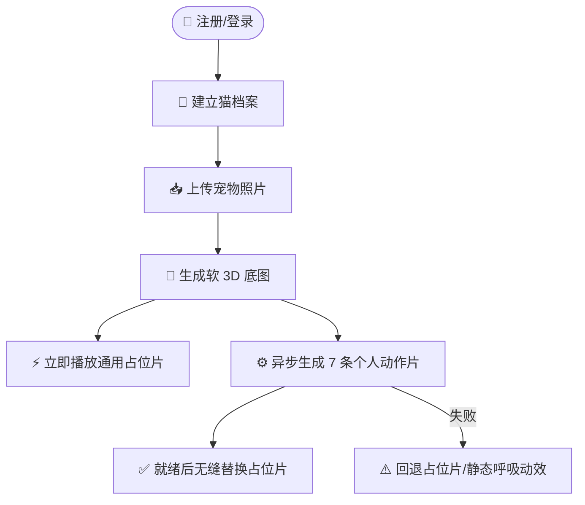
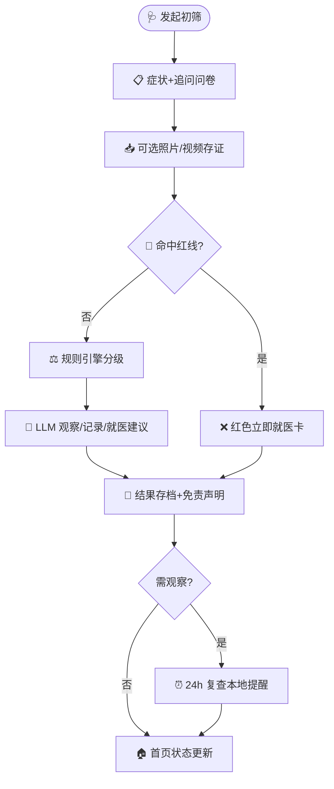
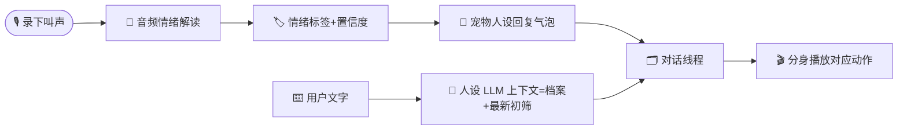
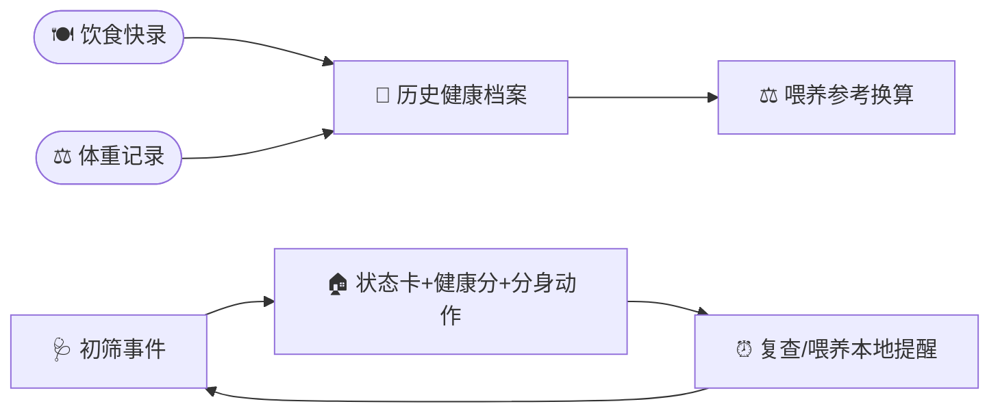

# 绒星(RongXing)产品需求文档 PRD

| 项 | 内容 |
| --- | --- |
| 产品名称 | 绒星(RongXing) |
| 标语 | 星光护绒,健康相伴 |
| 文档版本 | v1.0(共识锁定稿) |
| 日期 | 2026-11-16 |
| 状态 | 已确认,可进入架构与开发排期 |
| 关联文档 | `../architecture.md`(系统架构)、`FRD.md`(功能需求与验收标准) |
| 决策来源 | 四轮 grilling 访谈共识(32 条决策清单),本文档为其产品侧展开 |

## 🎯 产品概述

绒星是一款面向猫主人的 AI 宠物健康管理 App。用户上传宠物照片生成专属 2.5D 数字分身,建立宠物档案;通过结构化问卷完成健康风险初筛,通过叫声解读与宠物人设对话理解宠物情绪;饮食、体重与初筛记录沉淀为历史健康档案。三个界面以**宠物档案为数据枢纽**联动,形成「健康初筛 → 状态更新 → 饮食管理 → 历史记录」的闭环。

**产品边界声明:所有 AI 结果仅作为日常健康管理参考,不替代专业兽医诊断。** 该声明出现在每一条初筛结果、每一条聊天回复的上下文中,并写入用户协议。

### 背景与问题

- 猫善于隐藏病痛,腹式呼吸、尿闭等急症常被主人错过黄金就医窗口;主人缺乏「何时该观察、何时该立刻就医」的分诊知识。
- 现有宠物 App 多为记录工具或社区,缺少「档案 → 初筛 → 状态 → 喂养」一体化的日常健康管理闭环。
- 主人对宠物情绪与表达有强情感诉求,但市面「宠物翻译」多为纯娱乐噱头,缺乏与健康状态的结合。

### 目标用户

| 画像 | 描述 | 核心诉求 | 对应模块 |
| --- | --- | --- | --- |
| 新手猫主(25–35 岁,养猫 <2 年) | 对症状高度焦虑,缺乏分诊知识 | 「它这样要不要去医院?」 | 健康初筛、红线急症卡 |
| 资深多猫家庭(28–40 岁,2 只以上) | 记录负担重,需要统一管理 | 多宠档案、喂养与体重趋势 | 档案、饮食记录、历史档案 |

v1 仅服务**猫**;数据模型预留物种字段,狗为 v2 扩展。

### 价值主张

1. **分诊级安全感**:红线症状硬规则直送「立即就医」,不经过 AI 自由发挥。
2. **有温度的专属感**:每只猫拥有自己的 2.5D 动态分身,健康状态与情绪通过动作外显。
3. **闭环而非工具**:初筛驱动状态、状态驱动喂养与复查提醒、记录沉淀为可回溯档案。

## 🧭 目标与成功指标

内测规模:50–100 名猫主,TestFlight + 安卓 APK 直装,不上架应用商店。

| 类型 | 指标 | 目标 | 说明 |
| --- | --- | --- | --- |
| 北极星 | 周活跃记录宠物数 | 内测期持续上升 | 一周内至少 1 次饮食或初筛记录的宠物数 |
| 护栏 | 7 日留存 | ≥30% | 低于阈值暂停拉新,先修闭环 |
| 护栏 | 初筛流程完成率 | ≥70% | 进入问卷到产出结果的比例 |
| 护栏 | 红线就医提示点击率 | 观察并设基线 | 红线卡曝光后点击就医指引的比例,安全指标只升不降 |
| 观察 | 聊天周活、人均消息数 | 不设考核 | 情感卖点吸引力观察 |

## 🗂️ 范围定义

### v1 范围(三模块同时交付)

| 模块 | 功能 | 优先级 |
| --- | --- | --- |
| 数字分身首页 | 宠物档案 CRUD、2.5D 分身生成与动作播放、健康状态卡、健康分、饮食记录入口、喂养参考、历史健康档案 | P0 |
| AI 健康初筛 | 症状问卷(15 常见 + 6 红线)、照片/视频存证、规则分级、LLM 建议、结果存档、复查提醒 | P0 |
| 宠物聊天 | 录音情绪解读、宠物人设多轮对话(文字+录音混合)、上下文结合档案与最新初筛 | P0 |
| 支撑 | 统一账号(手机短信+邮箱密码)、每日配额、本地通知、隐私与注销、分享导出 GIF | P0/P1 |

### 明确不做(v1 排除项)

| 排除项 | 原因 |
| --- | --- |
| 定位、相机、小组件 tab | 参考图装饰元素,非共识范围 |
| 实时语音通话式对话 | 成本与延迟不可控 |
| 全量离线优先与同步协议 | MVP 成本过高,仅做浅离线(缓存+重试队列) |
| 账号合并 | 多凭证历史数据合并为 v2 难题 |
| 支付接入 | 仅预留订阅模型与付费墙接口位 |
| 服务端推送通道 | v1 用 RN 本地通知 |
| 食物拍照识别 / 扫码 | 手动快录已满足闭环 |
| 叫声模型从零训练 | 数据与科学共识不足,v1 用预训练音频+LLM 解读 |
| Rive 骨骼 / 外包绑骨 | 团队无绑骨产能,动作资产全部 AI 生成 |
| 照片/视频的 AI 诊断级分析 | 初筛路线 A:媒体只存证不分析 |

### v2 展望(仅登记,不承诺)

狗物种扩展、WebSocket 实时任务推送、全量离线同步、自采叫声数据微调(授权默认关)、服务端推送、微信登录、订阅支付落地、账号合并。

## 🔄 核心用户旅程

### 旅程一:建档与分身生成

### 旅程二:健康初筛与红线分流

### 旅程三:叫声解读与人设对话

### 旅程四:饮食管理与复查闭环

## 🧩 功能清单与数据联动

功能点编号与验收标准见 `FRD.md`(F01–F13)。联动规则的产品定义如下:

| 数据流 | 规则 |
| --- | --- |
| 初筛 → 首页 | 每次初筛写入健康事件;首页状态卡、健康分、分身动作读取「最新有效事件集合」 |
| 初筛 → 聊天 | 聊天人设上下文注入最新初筛状态;难受/紧急状态下宠物回复语气与动作同步 |
| 饮食/体重 → 档案 | 全部记录入历史档案,按日聚合;体重趋势驱动喂养参考换算 |
| 复查提醒 → 初筛 | 「需观察」结果 24h 后本地提醒复查;复查结果覆盖旧事件状态,闭环成立 |
| 档案 → 一切 | 物种/年龄/体重/绝育状态是分级规则、喂养公式、聊天人设的共同输入 |

**健康分产品定义**:百分制、纯规则扣分、扣分项可点开追溯;无任何初筛与事件时显示「未评估 --」,禁止显示默认 100,禁止 LLM 打分。明细权重见 `FRD.md` 附录 D。

## 🛡️ 合规、伦理与安全

| 项 | 产品要求 |
| --- | --- |
| 免责声明 | 每条初筛结果、聊天页常驻提示:「AI 结果仅供日常健康管理参考,不替代专业兽医诊断」 |
| 红线原则 | 6 类红线症状绕过 LLM,硬规则直送红色「立即就医」卡,附就医准备清单 |
| 医学表述 | 症状分级与建议参考公开兽医分诊资料[^1],文案标注「参考公开资料,非诊断」 |
| 个人信息 | 隐私政策+用户协议首启弹窗;最小必要采集;注销级联删除、15 天内物理清除[^2] |
| 训练授权 | 用户数据用于模型微调的授权**默认关闭**,单独弹窗同意,协议明示 |
| 商店类目 | 生活/健康类,不做医疗器械宣称,不使用「诊断」「治疗」等词作为功能名 |
| 媒体存证 | 照片/视频仅存证不分析;用户可单条删除;注销全清 |

## 💰 商业模式与配额

测试期全免费,以每日配额控制 AI 成本;订阅制在架构中预留(plan/entitlement 模型+付费墙接口位),v1 不接支付。

| 配额项 | 默认每日上限 | 超限行为 |
| --- | --- | --- |
| 健康初筛 | 10 次 | 提示明日再试,红线入口**不限额** |
| 分身生成 | 3 次 | 提示明日再试,已有分身不受影响 |
| 聊天消息 | 50 条 | 提示明日再试,历史可读 |

红线初筛不限额是安全决策:任何时候用户怀疑急症,都必须能走完初筛流程。配额数值后台可调,见 `FRD.md` F11。

## ⚠️ 风险与假设

| 风险 | 影响 | 缓解 |
| --- | --- | --- |
| 图生视频动作片一致性差(同底图不同动作长相漂移) | 专属感破裂 | 同底图+动作提示词约束;失败回退链;内测期人工抽检 |
| 叫声情绪缺乏科学共识 | 解读被质疑为噱头 | 定位娱乐+参考,展示置信度,文案不承诺准确 |
| AI 建议误导延误就医 | 安全与法律风险 | 红线硬规则 bypass LLM;全结果免责声明;护栏指标监控 |
| 免费期 AI 成本失控 | 现金流 | 每日配额+单用户成本看板+适配层可换低价模型 |
| 占位片与个人片替换穿帮 | 体验 | 替换仅在待机态触发,过渡淡入淡出 |
| 短信通道成本与资质 | 内测登录 | 限频 1/分钟、10/天;邮箱密码为备用通道 |

关键假设:内测用户愿意手动记录饮食;wanx i2v turbo 质量达到「风格化可接受」基线(不达标换可灵,适配层隔离)。

## 🚀 发布与迭代计划

| 里程碑 | 内容 | 周期(参考) |
| --- | --- | --- |
| M0 | 基础设施:账号、档案、配额、OSS/队列/适配层骨架 | 第 1–2 周 |
| M1 | 分身管线:底图+占位片库+个人片批量+播放与回退 | 第 3–5 周 |
| M2 | 初筛:问卷、规则引擎、红线、LLM 建议、存档、健康分 | 第 6–8 周 |
| M3 | 聊天+饮食+体重+提醒+历史档案+分享导出 | 第 9–11 周 |
| M4 | 内测发布(TestFlight+APK)、指标看板、合规文案终稿 | 第 12 周 |

## 📚 术语表

| 术语 | 定义 |
| --- | --- |
| 数字分身 | 由宠物照片生成的软 3D 风格底图及其 7 条动作片组成的可播放形象 |
| 动作片 | ≤5s、720p、首尾对齐的 MP4 无声循环视频,对应一个动作枚举 |
| 占位片库 | 一次性 AI 批量生成的 3 体型×7 动作通用片,冷启动与兜底用 |
| 健康事件 | 初筛/记录产生的、影响首页状态与健康分的结构化事件 |
| 红线症状 | 命中即 bypass LLM、直送立即就医卡的 6 类急症 |
| 状态档 | normal(正常)/ observe(需观察)/ vet(建议就医)/ urgent(紧急) |
| 浅离线 | 资产缓存+聊天缓存+待发送重试队列,不含全量离线同步 |

[^1]: 兽医分诊与猫科急症公开参考资料,如 Cornell Feline Health Center 症状指南 https://www.vet.cornell.edu/departments-centers-and-institutes/cornell-feline-health-center ;营养需求公式见 NRC《Nutrient Requirements of Dogs and Cats》 https://nap.nationalacademies.org/catalog/10668/nutrient-requirements-of-dogs-and-cats 。
[^2]: 《中华人民共和国个人信息保护法》全文 https://www.gov.cn/xinwen/2021-08/20/content_5632486.htm 。
