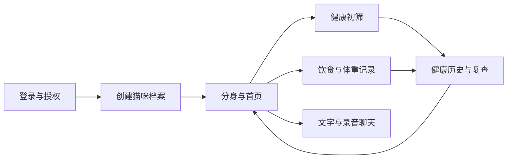

# 绒星 App 项目规划与设计参考

_规划草案 · 2026-11-17 · 面向产品、设计、开发与测试_

---

## 🎯 目标与现状

绒星是一款面向猫主人的健康管理与陪伴 App。首版以猫咪档案为中心，连接数字分身、健康初筛、日常记录和聊天，面向 50–100 名猫主开展内测。产品目标、功能范围和验收规则分别以 [PRD](PRD.md)、[FRD](FRD.md) 和 [架构文档](../architecture.md) 为依据；本文件负责把它们转成设计和交付顺序。

目前工作区已有需求和架构文档，以及 Figma 设计规范与 5 张页面画板；未发现 App 或后端源码。Figma 画面是视觉与布局参考，部分功能、状态和流程尚未设计或实现。进度不能根据效果图推断为开发完成。

## 🎨 Figma 设计基准

[打开绒星 Figma 文件](https://www.figma.com/design/sGhmzVC6reNoJdpy73X1zI/Untitled)（文件当前名为 Untitled，页面为「绒星」）。在 Figma 中使用原型入口「绒星 · 首页体验」可体验已连接的底部导航与初筛入口。文件权限沿用现有设置。

| 画板 | Figma 设计 | 本地预览 | 参考范围 |
| --- | --- | --- | --- |
| 基础规范 | [品牌与基础规范](https://www.figma.com/design/sGhmzVC6reNoJdpy73X1zI/Untitled?node-id=21-115) | — | 色彩、字体、间距、圆角和 Logo |
| 核心组件 | [组件规范](https://www.figma.com/design/sGhmzVC6reNoJdpy73X1zI/Untitled?node-id=21-116) | — | 按钮、状态、卡片、输入与导航 |
| 页面原则 | [使用原则与场景](https://www.figma.com/design/sGhmzVC6reNoJdpy73X1zI/Untitled?node-id=21-117) | — | 页面布局、表达与参考图 |
| 首页 | [首页画板](https://www.figma.com/design/sGhmzVC6reNoJdpy73X1zI/Untitled?node-id=22-309) | [PNG](../../视觉参考/22-309.png) | 猫咪、健康状态、今日概览、快捷操作 |
| 健康 | [健康画板](https://www.figma.com/design/sGhmzVC6reNoJdpy73X1zI/Untitled?node-id=23-393) | [PNG](../../视觉参考/23-393.png) | 初筛、紧急症状、健康历史入口 |
| 健康初筛入口 | [初筛入口画板](https://www.figma.com/design/sGhmzVC6reNoJdpy73X1zI/Untitled?node-id=23-394) | [PNG](../../视觉参考/23-394.png) | 对象确认、初筛说明、紧急提示 |
| 聊聊 | [聊聊画板](https://www.figma.com/design/sGhmzVC6reNoJdpy73X1zI/Untitled?node-id=23-395) | [PNG](../../视觉参考/23-395.png) | 会话样式、输入区域、服务边界提示 |
| 我的 | [我的画板](https://www.figma.com/design/sGhmzVC6reNoJdpy73X1zI/Untitled?node-id=23-396) | [PNG](../../视觉参考/23-396.png) | 用户、猫咪、记录、提醒与隐私入口 |

PNG 快照位于本地 `视觉参考/` 目录（按 .gitignore 未入库），克隆仓库后仅 Figma 链接可用。

使用规则：实现前读取对应 Figma 节点的当前变量、组件和布局，PNG 仅作快照；以白色背景、暖橙 `#FEAE36` 和浅暖灰卡片为视觉方向。亮橙底上的文字使用深色。示例文案、猫咪裁剪图和局部静态数据均为设计示意，不代表真实用户数据或最终资产。设计稿为 390 × 844 基准，开发时还需适配不同屏幕、安全区和系统字号。

原型当前仅覆盖四个 Tab 切换、初筛入口与返回，其他按钮不代表已有完整交互。Figma 在检查时提示变更已保存在本地、等待联网同步；重新联网并确认同步完成后，其他设备才能可靠查看最新版本。

## 🗺️ 产品范围与优先级

PRD 明确首版同时交付数字分身首页、健康初筛和宠物聊天；下面的先后顺序用于降低依赖风险，并不改变首版承诺。

| 顺序 | 范围 | 对应需求 | 阶段成果 |
| --- | --- | --- | --- |
| 1 | 用户同意、登录、猫咪档案及多猫切换 | F01、F02、F12 | 能安全建档，各猫数据隔离 |
| 2 | 首页、分身生成和降级播放 | F03、F04 | 占位资源可用，个人分身异步生成并可回退 |
| 3 | 初筛问卷、红线、结果和历史 | F05、F06 | 确定性分级、急症就医引导、可追溯结果 |
| 4 | 饮食、体重、复查提醒 | F07、F08、F10 | 快录、首页同步、历史和复查闭环 |
| 5 | 文字与录音聊天 | F09 | 每猫独立线程、音频解读与失败降级 |
| 6 | 配额、隐私、分享和内测发布 | F11–F13 | 风险控制、数据删除、可安装测试包与指标 |

不纳入 v1：支付、账号合并、全量离线同步、服务端推送、实时语音通话、食物拍照识别及照片/视频 AI 诊断；完整排除项见 PRD。P1 功能的降级须与产品负责人确认，不能自行删除 P0。

## 🖼️ 待补充的设计清单

| 优先级 | 待设计页面或状态 | 对应需求与验收重点 |
| --- | --- | --- |
| P0 | 首启同意、手机与邮箱登录、验证、错误及恢复 | F01、F12；同意版本、限频及校验清楚可见 |
| P0 | 建档、照片上传、多猫切换、档案编辑与删除 | F02、F03；未知生日、上传失败、删除确认与多猫隔离 |
| P0 | 分身生成中、占位、成功、超时与降级 | F03；加载不白屏，个人片就绪时平滑替换 |
| P0 | 初筛问卷、症状追问、可选存证、结果与紧急就医 | F05；必答校验、红线立即分流、规则结果先展示 |
| P0 | 结果的正常 / 观察 / 就医 / 紧急状态、健康分明细、历史与复查 | F04、F06；无记录为「未评估」，结果与来源可追溯 |
| P0 | 饮食快录、体重录入、喂养参考与无体重提示 | F07、F08；单位、范围校验、保存结果与首页同步 |
| P0 | 聊天空态、文字发送、录音、权限、解读与失败 | F09；娱乐性定位、不确定性、医疗边界和紧急提示 |
| P0 | 提醒授权、隐私协议、训练授权、数据删除与注销 | F10、F12；拒绝通知不阻断流程，训练授权默认关闭 |
| P1 | 体重趋势、用量、分享 GIF、离线待同步 | F08、F11、F13；按 FRD 核实范围和降级 |

每个流程至少补齐默认、加载、空、失败及成功状态；按需补充禁用、权限拒绝、弱网、长文本与大字号。先用 Figma 的变量和组件扩展，再连原型并进行视觉验收。现有导航图标和猫咪素材需整理为可用、授权明确的正式资产。

## 🗓️ 里程碑与依赖

以下 12 周沿用 PRD 的参考节奏，按已有产品设计与架构材料、具备移动端、后端、设计和测试能力的团队估算；人员、预算、AI 供应商可用性和平台资质尚未确认，因此不是交付承诺。周期从项目正式启动算起，需每周复核。

| 里程碑 | 参考时间 | 交付内容 | 完成条件 |
| --- | --- | --- | --- |
| M0 基础 | 第 1–2 周 | 补关键交互稿；项目骨架、账号、同意、档案、基础部署和配额 | 双端可运行；账号及猫咪增改查与隔离通过；关键服务可在测试环境运行 |
| M1 分身 | 第 3–5 周 | 上传、任务队列、占位资源、个人动作片、播放器和回退 | 对照 F03 验证生成、轮询、失败、重复提交和回退；供应商质量与成本有实测结果 |
| M2 初筛 | 第 6–8 周 | 问卷、红线规则、分级、建议、存档、健康分及结果稿 | 红线绕过 LLM 且不限额；AI 不可用仍能获得规则结果；FRD 对应 AC 通过 |
| M3 日常与聊天 | 第 9–11 周 | 饮食、体重、历史、复查、本地提醒、文字与录音聊天、分享 | 三条核心旅程跑通；猫咪数据隔离；权限拒绝、弱网、失败态可用 |
| M4 内测 | 第 12 周 | 双端测试包、埋点、隐私文案、人工审核与小规模回归 | 发布门槛通过、阻断问题关闭；TestFlight 与安卓 APK 的分发条件得到确认 |

关键依赖：猫咪档案与同意先于用户数据；媒体上传和异步任务先于分身与音频；症状规则和红线清单先于结果页和聊天安全引导；历史与提醒依赖初筛、饮食、体重事件；内测包依赖证书、签名、测试账号与合法文案准备。

## 🏗️ 实施与验收

技术方向沿用现有架构：React Native + Expo、React Navigation + Zustand；FastAPI、MySQL、Redis/arq、对象存储和 AI Provider 适配层。上述选型是已有方案，启动前需要验证当前 SDK 与原生通知、构建服务、短信和 AI 接口的实际兼容性；无需在规划阶段假设已有实现。

每项任务完成时，产品对照 FRD 的 `Fxx` / `AC` 核验，设计对照 Figma 的页面与状态，开发补齐接口错误处理，测试覆盖关键成功路径与失败路径。核心发布检查：

1. 登录与授权、建档、切猫、注销与用户数据隔离通过；训练授权默认关闭。
2. 六类红线规则逐项验证，紧急初筛不受普通配额限制且不调用 LLM；提供明确就医引导。
3. 无初筛数据不显示默认 100 分；分级、规则版本、结果和历史可追溯；AI 超时有模板降级。
4. 分身和录音任务的超时、失败、权限拒绝与回退有可见反馈；照片/视频存证不做诊断分析。
5. iOS 与 Android 真机覆盖导航、安全区、大小屏、系统字号、触控目标与核心无障碍；白底暖橙的文字和图标对比度需逐项实测。
6. 完成权限、隐私与删除流程核验，验证日志不泄露敏感信息；测试包安装、升级与回归通过。

内测指标沿用 PRD：周活跃记录宠物数持续观察，7 日留存目标 ≥30%，初筛完成率目标 ≥70%，红线就医提示点击率建立基线；聊天周活和消息数作观察指标。需要在实现埋点前明确事件定义、去重口径及数据收集授权。

## 📌 启动清单与待决定事项

1. 确认团队角色、每周投入、预算与启动日期，再据此重排里程碑；12 周仅作初始参考。
2. 确认 Figma 已同步、团队访问权限与设计负责人；在对应画板上补关键流程、状态和可访问性标注。
3. 组织产品、设计、开发与兽医专业人员评审红线、问卷和就医文案；本规划不替代专业审核。
4. 验证分身生成质量、供应商能力、额度与成本，明确失败回退素材；检验 Expo 原生模块与通知构建链。
5. 确定短信及邮箱服务、存储、测试环境、iOS/Android 内测分发资质与数据保留执行方式。
6. 建立 F01–F13 需求到 Figma 画板、接口、任务与 AC 的追踪表；每次范围或设计变更同步更新。

规划依据：[产品 Brief](产品Brief.md)、[PRD](PRD.md)、[FRD](FRD.md)、[架构文档](../architecture.md) 与上述 Figma 文件。详细需求冲突应先回到原文并由产品负责人确认，勿将示例画面作为业务规则。
