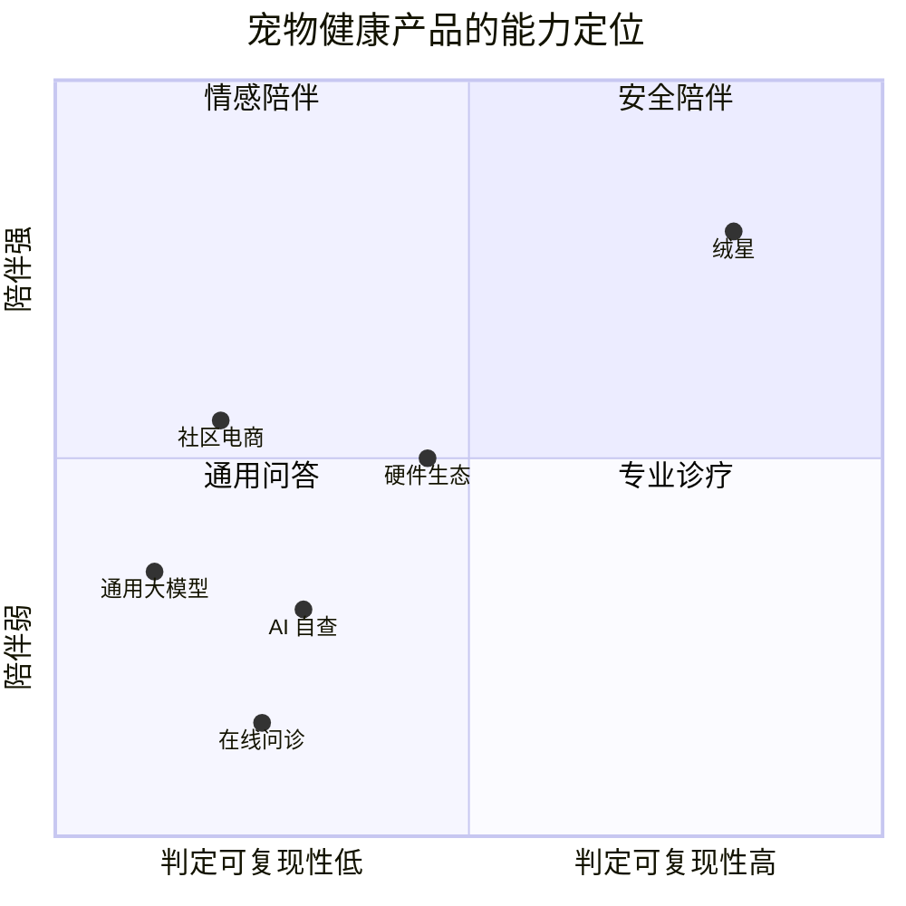

# 绒星：项目创新点与竞品对比

> 本文独立成篇，供申报书、答辩材料、评审问答直接引用；演讲稿见 [技能大赛-数据库与管理后台创新逐字稿](技能大赛-数据库与管理后台创新逐字稿.md)。
> 竞品信息口径：截至 2026-11，以各产品公开资料与当前版本为准，功能可能随版本变化；本文只做能力对比，不评价具体厂商的医疗水平。
> 事实边界：内测阶段，无真实用户数据与第三方背书；DashScope 真实凭证尚未接入，分身/动图质量以 fake provider 链路验收；兽医专业评审尚未签署。文中凡涉及"待验收"的能力均已标注。

---

## 一、一句话定位

绒星不做"更会聊天的宠物 AI"，也不卖硬件。它把**分诊级的安全感**做成软件能力：**确定性规则定级、大模型只负责表达、档案闭环承载记忆、运营后台兜住责任**。

面向新手猫主（25–35 岁、养猫不足两年、对症状高度焦虑）回答一个具体问题：**"它这样，要不要去医院？"**

## 二、创新总览

| # | 创新点 | 一句话 | 落点 |
| --- | --- | --- | --- |
| 1 | 安全双引擎 | 规则定级、模型表达，红线判定完全不经过 LLM | `backend/rules/*.yaml`、`services/triage.py` |
| 2 | 结论可复现 | 每条初筛存档规则版本号，历史可重算 | `health_screenings.rules_version` |
| 3 | 红线不限额 | 急症初筛豁免配额，安全不被商业化拦截 | `routers/screening.py`、`services/quota.py` |
| 4 | 合规内建 | 注销是 15 天状态机，删除可验证 | `deletion_jobs`、`services/privacy.py` |
| 5 | 责任链后台 | 零新增密码体系、写操作审计快照、AI 成本账本 | `admin_audit_logs`、`ai_usage_logs` |
| 6 | 陪伴式入口 | 照片生成专属分身，健康状态通过动作外显 | `pet_avatars`、`avatar_clips`、`motion_batch` |

前两项解决"敢不敢相信"，第三、四项解决"敢不敢用、敢不敢交数据"，第五项解决"团队能不能长期运营"，第六项解决"用户愿不愿意每天回来"。

---

## 三、创新点详述

### 创新一：安全双引擎——规则定级，模型表达

**痛点.** 宠物健康是典型的"低容错"场景：猫善于隐藏病痛，主人又缺乏分诊知识。如果让大模型直接回答"要不要就医"，同一个问题两次可能给出不同结论，甚至漏掉尿闭、呼吸急促这类急症。

**行业通行做法.** 一条路是纯 AI 问答，快但不可控；另一条是纯人工问诊，准但贵、要排队、夜间不一定接得通。

**我们的做法.** 把"判定"和"表达"拆成两个引擎：

- **判定引擎**：红线命中、症状分级、健康分，全部由版本化 YAML 规则计算，是纯函数、可单测、结果确定；
- **表达引擎**：大模型只把规则结果写成"人话"建议，**不参与定级、不参与打分**；
- **红线旁路**：命中红线直接返回模板化的就医卡，**完全不调用 LLM**；模型失败或超时，规则结果照常返回，不空手。

**创新性在哪.** 不是"用 AI 做宠物医疗"，而是**把安全关键的判断从概率模型里拿出来，放进可审计的确定性代码**。模型可以换、可以挂、可以降级，但"是否需要就医"这条线不会漂移。

**证据.** `backend/rules/redlines.yaml`、`symptoms.yaml`、`scoring.yaml`；`services/triage.py`；固定文案由 `tests/test_copy_audit.py` 逐字锁定。

**局限.** 规则目前覆盖 15 类常见症状、6 条红线，覆盖不到的症状只能降级为通用建议；规则需兽医评审签署（尚未执行）。

### 创新二：结论可复现——每条记录都带"规则版本号"

**痛点.** 健康类产品的历史结论一旦无法解释，就无法复盘、无法举证、也无法迭代。规则或模型升级后，三个月前那条"建议就医"是怎么判的，很多产品答不上来。

**我们的做法.** 每条初筛结果落库时写入当时的 `rules_version`；规则调整走 YAML 升版本，不改代码、不覆盖历史。

**创新性在哪.** 这是把**实验记录**的思想搬进业务数据库：结论不是一段文本快照，而是"输入 + 规则版本 + 输出"的可重算三元组。同一条历史记录，用当时的规则可以复算出同样的结论。

**证据.** `health_screenings.rules_version`；`rules/*.yaml` 的 `version` 字段是契约的一部分，改规则必须升版本。

**局限.** 旧规则文件需要长期保留（当前依赖版本库归档）；后续应补一个"按版本回放"的内部工具，才算闭环。

### 创新三：红线不限额——把安全写进配额机制

**痛点.** 商业化产品的配额与付费墙，天然会把"最着急的那次咨询"挡在门外。急症往往发生在深夜、发生在免费额度用完之后。

**我们的做法.** 配额按服务器 UTC 自然日计算（初筛 10 次 / 分身 3 次 / 聊天 50 次）；**命中红线的初筛直接豁免配额**，只受安全限频约束。

**创新性在哪.** 大多数产品把"安全优先"写在品牌口号里，我们把它写进**计费代码的分支**：`if not redline_hit: consume_quota(...)`。这是一条可以被代码审查验证的产品决策，而不是文案。

**证据.** `routers/screening.py` 中红线命中后跳过 `quota_gate`；`services/quota.py` 的扣减与业务写同事务，失败请求不烧配额。

**局限.** 豁免可能被恶意刷取，目前靠限频兜底，后续需要设备指纹与风控策略。

### 创新四：合规内建——注销是状态机，不是一条 DELETE

**痛点.** 《个人信息保护法》要求删除权与单独同意，但大量小产品只做一个"注销"按钮：状态一改，数据还在；或者删得太快，用户后悔无法恢复。

**我们的做法.**

- **注销状态机**：`active → deletion_pending → purged`。提交后立即冻结账号、吊销会话，生成 `deletion_jobs` 作业，进入 **15 天冷静期**；到期由后台 worker 定时物理清除数据库记录与对象存储中的照片、视频，审计日志匿名化保留；
- **同意版本化**：隐私、协议、训练授权分别记录版本与是否同意，训练授权默认关闭，文案升级后需重新确认；
- **可观测**：后台总览直接提示"有待处理的注销申请"。

**创新性在哪.** 把合规从"法务文档里的承诺"变成**数据库里可查询、可验证、可追责的作业记录**。用户问"我的数据删了吗"，能拿出时间与结果，而不是一句"已处理"。

**证据.** `deletion_jobs` 表、`services/privacy.py` 的 `purge_due`、`worker.py` 的定时清扫。

**局限.** 15 天冷静期是对"立即删除"诉求的折中；物理清除依赖 worker 正常运行，需要监控告警兜底。

### 创新五：责任链后台——不新增一套密码，只增加一条责任链

**痛点.** 小团队做后台，最常见的做法是"再建一张管理员表、再设一套密码"。多一套密码就多一个被拖库的攻击面；而没有审计的后台，出了问题只能靠回忆。

**我们的做法.**

- **零新增账户体系**：管理员直接用 App 账号登录，复用同一套 JWT、argon2 哈希与限流；权限由服务端 `ADMIN_EMAILS` 白名单决定；
- **封禁即失效**：停用账号时，同一事务内吊销该用户全部刷新令牌，恢复后旧设备也不能续期；
- **审计快照**：每次写操作写入 `admin_audit_logs`，记录操作人邮箱、昵称、动作、目标与变更前后明细；邮箱昵称是快照，管理员账号被删后记录依然完整；
- **自锁保护**：不能停用自己，不能操作注销冷静期账号；
- **成本账本**：`ai_usage_logs` 记录每次调用的厂商、模型、token、媒体时长与估算成本，并归因到用户与任务；`quota_denials` 记录每一次配额拒绝，业务回滚也不丢；
- **值班告警**：红线率异常、任务失败率超 10%、待处理注销、配额拒绝激增四类告警直接呈现在总览页。

**创新性在哪.** 后台的定位不是"看数据的面板"，而是**责任链的落点**：每一次权限动作可追溯，每一分 AI 成本可归因，每一个异常有告警。对一个小团队来说，这比多十个图表更能降低运营风险。

**证据.** `services/admin_stats.py`、`admin_audit_logs`、`ai_usage_logs`、`quota_denials`；管理台 6 个模块：总览、用户、宠物、初筛、AI 与成本、审计。

**局限.** 当前后台的写操作只有"停用/恢复账号"，审计覆盖面会随功能扩展；管理员身份依赖邮箱安全，后续应加二次验证。

### 创新六：陪伴式入口——把健康管理藏进"它"身上

**痛点.** 健康记录最大的敌人是依从性：让用户每天填表，三天就放弃。

**我们的做法.** 用猫咪自己的照片生成 2.5D 数字分身（软 3D 底图 + 7 个动作短片），首页的分身会随健康状态与情绪切换动作；饮食、体重、初筛、聊天共享同一份档案，记录会沉淀成时间线，而不是散落在四个工具里。

**创新性在哪.** 市面上的"陪伴"和"健康"通常是两件事：硬件负责监测，社区负责情感。我们把**健康状态变成可见的表情与动作**——用户为了看猫，顺手完成了记录；记录越完整，分诊越准，形成正循环。

**证据.** `pet_avatars` / `avatar_clips`、占位片回退链（个人片→占位片→静态图）、`health_events` 驱动的状态档。

**局限.** 分身与动图的真实生成质量依赖外部模型，目前以 fake provider 验收，真实样张待凭证接入后评估；占位素材是程序化生成的临时资产。

---

## 四、市面上的软件：五类玩家

### 4.1 硬件生态派（小佩 PETKIT、Furbo、Petcube、Whistle、PetPace、Tractive）

以智能猫砂盆、喂食器、饮水机、摄像头、项圈为入口，用设备数据做健康提醒。PETKIT 在 2026 年 8 月发布 AI 健康助手 Kitbo（部分功能预计 2026 年底上线），把猫砂盆、饮水、进食数据汇总成个性化健康基线；其 AI 摄像头可识别粪便性状、尿液健康、活动与叫声异常，并支持多猫面部识别。Whistle、PetPace 等项圈产品则主打活动、睡眠、心率、体温等客观指标。

- **强项**：客观、连续、自动化，不需要用户手填；硬件即渠道。
- **短板**：必须先买设备；判断多为"行为异常提醒"，不是症状分级与分诊；数据锁在自家生态。
- **与绒星的关系**：互补大于替代。我们没有传感器数据，但有症状问答、规则分级与档案闭环。

### 4.2 在线问诊派（京东宠物云医院、微宠医、蘑菇宠医、瑞鹏/宠爱国际、人人宠等）

以执业兽医为核心，7×24 在线接诊，部分平台打通线下医院、处方粮与药品。

- **强项**：有资质、能开药、能判断复杂病情，是急症与重症的最终兜底。
- **短板**：按次或会员收费，夜间与高峰期要排队；医生水平与响应质量参差；判断依赖个人经验，系统层不可复现；平台档案与日常记录往往是两套。
- **与绒星的关系**：我们是"分诊层"，不是"诊疗层"。红线命中时，我们做的是**把用户尽快推到他们那里**，而不是留住用户。

### 4.3 AI 自查派（宠智灵等）

以 AI 问答、症状自查为主要形态，输入症状后给出可能性与建议，部分产品接入知识库。

- **强项**：即时、低门槛、覆盖长尾问题。
- **短板**：公开资料未展示确定性规则分级、结果版本化与审计机制；输出质量随模型波动；免责与红线边界通常较弱。
- **与绒星的关系**：形态相近，但我们的差异不在"模型更强"，而在**判定是否可复现、急症是否有硬旁路、数据是否可追溯**。

### 4.4 通用大模型（豆包、文心一言、ChatGPT 等）

用户直接把症状贴进对话框。

- **强项**：免费、即时、知识面广，能处理开放问题。
- **短板**：没有宠物档案与历史，没有分诊规则，没有红线兜底，没有合规与审计；同一问题两次答案可能不同，存在幻觉风险。
- **与绒星的关系**：它们是"通用大脑"，我们是"带档案、带规则、带责任"的垂直产品。

### 4.5 社区电商派（波奇宠物、有宠等）

以内容社区、电商、服务预约为主，健康内容多为科普文章与经验帖。

- **强项**：流量、内容、交易闭环。
- **短板**：健康能力以内容和导购为主，缺少个体化的分诊与档案。
- **与绒星的关系**：受众重叠，但解决的不是同一个问题。

---

## 五、能力对比矩阵

> ● 具备　◐ 部分具备或依赖条件　○ 公开资料未展示。仅比较公开可见的产品能力，不代表厂商实际服务质量，也不代表厂商内部没有该能力。

| 能力维度 | 绒星 | 硬件生态派 | 在线问诊派 | AI 自查派 | 通用大模型 | 社区电商派 |
| --- | --- | --- | --- | --- | --- | --- |
| 7×24 即时响应 | ● | ● | ● | ● | ● | ◐ |
| 症状分级 / 分诊 | ● | ◐ | ● | ◐ | ○ | ○ |
| 红线急症直达就医 | ● | ○ | ◐ | ◐ | ○ | ○ |
| 判定可复现、可追溯 | ● | ○ | ○ | ○ | ○ | ○ |
| 长期健康档案闭环 | ● | ◐ | ◐ | ◐ | ○ | ◐ |
| 零硬件门槛 | ● | ○ | ● | ● | ● | ● |
| 执业兽医 / 可开药 | ○ | ○ | ● | ○ | ○ | ○ |
| 客观生理数据 | ○ | ● | ○ | ○ | ○ | ○ |
| 陪伴 / 情感连接 | ● | ◐ | ○ | ○ | ◐ | ◐ |
| 隐私删除可验证 | ● | ◐ | ◐ | ○ | ○ | ◐ |
| AI 成本可核算 | ● | ◐ | ◐ | ○ | ○ | ◐ |

矩阵读法：**没有任何一列是全满的**。硬件派强在数据、问诊派强在资质、通用模型强在知识面；绒星选择的是"分诊 + 陪伴 + 可追溯"这一列，并主动放弃硬件与诊疗资质。

> 横轴衡量"系统层的可复现与可审计"，不是医疗水平；在线问诊的医疗质量高，但结论依赖医生个人经验，难以系统复现。

---

## 六、绒星的五个特点（差异化）

1. **软件定义，零硬件门槛。** 不卖设备，不要求用户先花几百上千元；一部手机、一张照片就能开始。对新手猫主，决策成本最低。
2. **确定性安全。** 红线与分级由规则计算，可单测、可复现、可版本化；模型只是"嘴"，不是"脑"。这是同类 AI 产品最难同时具备的一条。
3. **合规是产品机制，不是法务附件。** 注销状态机、同意版本化、审计快照，都能在后台与数据库里被看见、被验证。
4. **陪伴驱动依从性。** 专属分身让"看猫"变成每天打开 App 的理由，记录顺手完成；健康数据因此更连续，分诊更准。
5. **运营可持续。** AI 成本可归因到用户、任务、模型；配额调整有拒绝数据支撑；后台有告警、有审计、有自锁保护。学生项目常见的"能跑但养不起"，在这里被当成一等问题处理。

其中第 2、4 两条，加上"初筛—饮食—体重—聊天共享同一档案"的闭环，是竞品**难以同时复制**的组合：硬件派缺规则，问诊派缺陪伴，通用模型缺档案与责任。

---

## 七、我们不是什么（边界声明）

- **不是在线问诊平台**：没有执业兽医，不诊断、不开药、不替代到院检查；红线命中时只做就医引导。
- **不是硬件厂商**：没有项圈、摄像头、猫砂盆数据；判断依据是用户描述 + 档案，不是传感器。
- **不是通用 AI 套壳**：有版本化规则、有档案、有红线旁路、有免责与审计；模型可替换、可降级。
- **不是诊断工具**：所有 AI 结果仅作日常健康管理参考，免责声明在每条初筛与每条聊天中可见。
- **内测事实**：50–100 名猫主的定向量测阶段，尚无真实用户数据、评价或媒体背书；真实模型质量与兽医评审待验收。这一点在答辩中应主动说明，而不是回避。

---

## 八、答辩口径

### 8.1 60 秒对比话术

> 市面上大概五类玩家：卖硬件的、做问诊的、做 AI 自查的、通用大模型、宠物社区。
> 硬件派有数据但要先买设备，问诊派有医生但要收费排队，通用模型什么都懂但没有档案、没有红线、也不负责。
> 绒星选的是中间那层——**分诊层**：用确定性规则判断"要不要就医"，用大模型把结论说成人话，用档案把每次记录接起来，用后台把成本和责任管起来。
> 我们不替代兽医，也不卖硬件；我们让用户在半夜最慌的那五分钟里，得到一个**说得清、可复现、有兜底**的答案。

### 8.2 三句话总结

- 别人卖设备，我们卖**决策**；
- 别人卖医生，我们卖**分诊**；
- 别人卖模型，我们卖**可追溯的安全感**。

---

## 九、资料来源与口径

- PETKIT 2026 全球发布与 Kitbo AI 健康助手：[petkit.com 发布稿](https://www.petkit.com/blogs/blog/2026-petkit-global-launch-see-the-small-things-early)、[Kitbo 产品说明](https://www.petkit.com/blogs/blog/kitbo-petkits-ai-powered-pet-health-assistant-for-smarter-pet-care)
- PETKIT App 功能（猫砂盆/进食/饮水/活动追踪、AI 摄像头健康监测、多猫识别）：[Google Play 应用页](https://play.google.com/store/apps/details?id=com.petkit.oversea)
- 宠物在线问诊平台实测（京东宠物云医院、微宠医、蘑菇宠医、瑞鹏/宠爱国际、宠智灵等）：[2026 实测 7 大平台](https://www.sina.cn/news/article/comos_niwxqyp5006342.html)、[2026 宠物问诊 App 实测](https://weibo.com/2/detail/comos:nituncv7766196)
- 智能项圈、AI 摄像头与健康可穿戴的技术综述：[宠物科技创新综述](https://www.sunqi.org/pet-tech-innovation-zh.html)
- 宠物健康软件市场规模与增速（付费报告摘要，仅作行业背景）：[QYResearch 摘要](https://www.168report.com/reports/12252346/pet-health-software)

> 以上为公开资料，功能与定价可能已变化；正式对外材料引用前，建议按各产品最新版本复核一遍，并在答辩中说明"以公开资料为准"。
